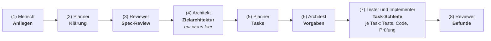
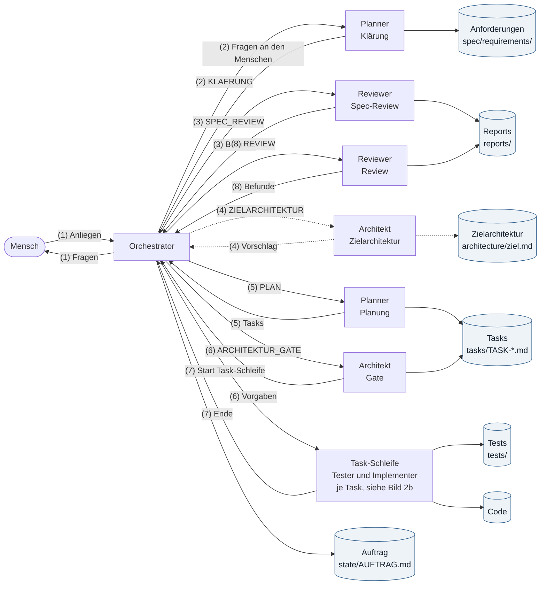
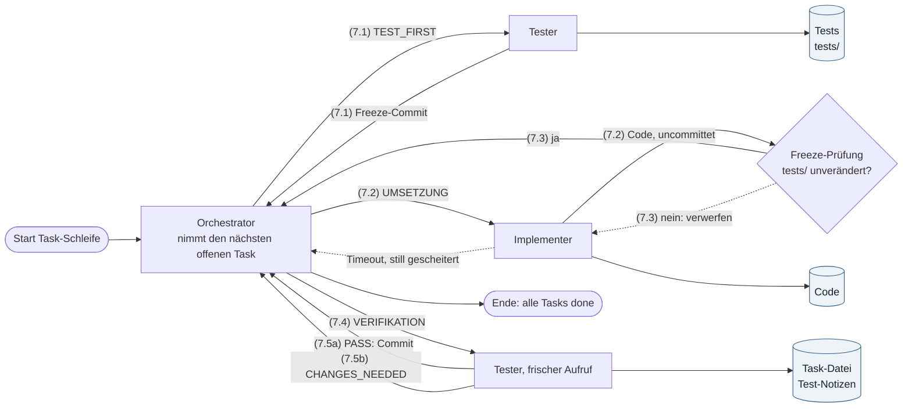
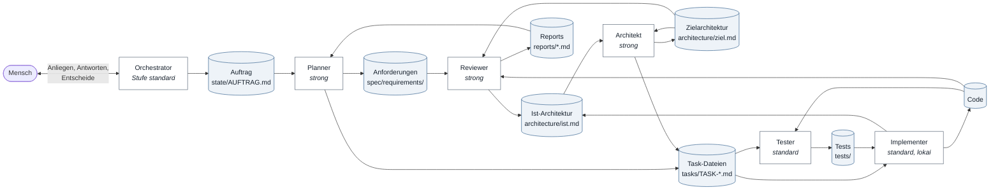
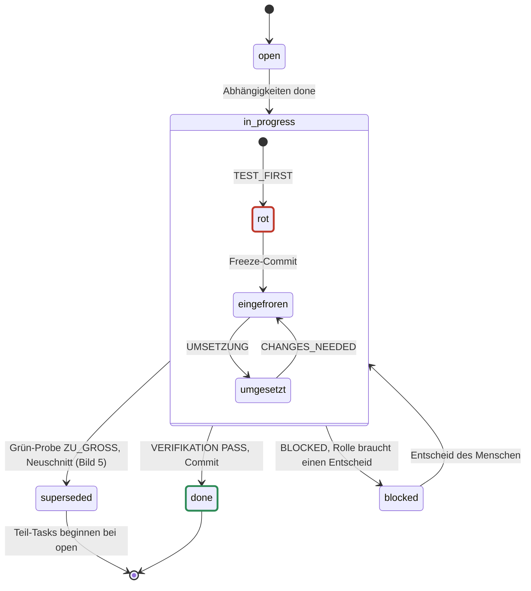
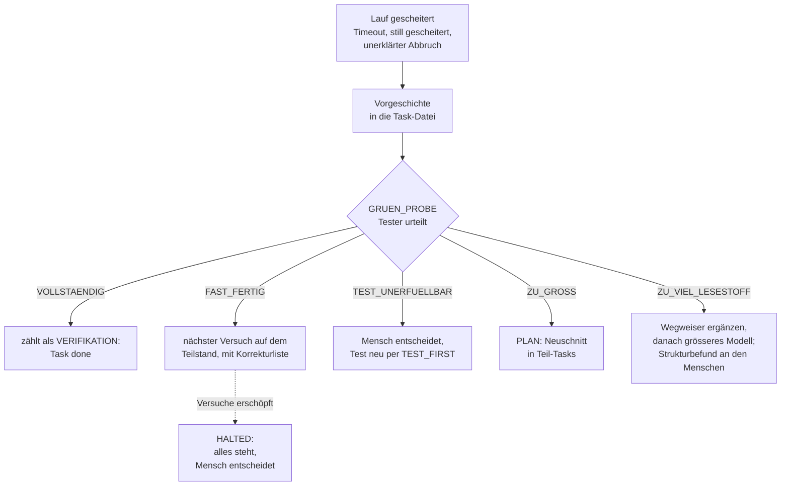
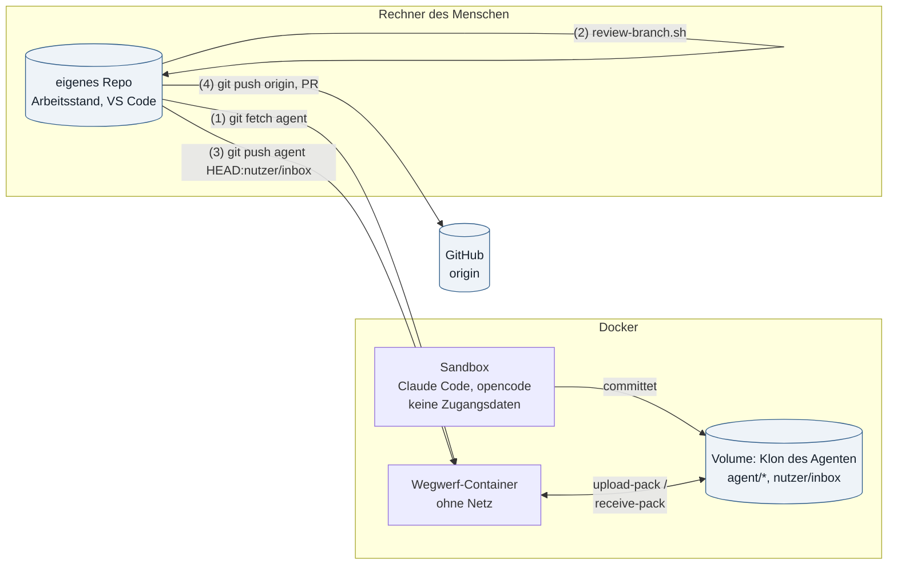

# Agent-Workflow: Softwareentwicklung mit spezialisierten Agenten

Eine Methode, um ein Software-Vorhaben durch mehrere spezialisierte
Agenten selbständig umsetzen zu lassen, ohne dass Qualität oder
Kontrollierbarkeit leiden – auch (und gerade) wenn einzelne Rollen auf
günstigen oder lokalen Modellen mit begrenztem Kontextfenster laufen.

**Diese Datei zeigt, wie der Workflow abläuft** – zum Lesen am Stück.
Daneben:

| Datei | Beantwortet |
|---|---|
| `AGENT_WORKFLOW_REFERENZ.md` | Was genau gilt im Fall X? Baustein-Katalog, Verträge, Formate, Regeln im Detail |
| `USERMANUAL.md` | Wie richte ich das ein und bediene es? |
| `HARNESS.md` | Welcher Harness kann was, wie laufen Rollen auf anderen Modellen? |
| `DECISIONS.md` | Warum ist es so – und was ist schon schiefgegangen? |
| `sandbox/README.md` | Wie läuft der Agent abgeschottet, wie kommen Resultate zu mir? |
| `project-template/.agent/agents/*.md` | Was eine Rolle **tatsächlich** tut (normativ) |

> Die Rollen-Dateien sind die Quelle der Wahrheit: sie sind der Text, den
> der Agent liest. Diese Datei und die Referenz erklären den Zusammenhang
> und dürfen deshalb keine Regel in abweichendem Wortlaut wiederholen – im
> Zweifel gilt die Rollen-Datei.

## Die Idee in fünf Sätzen

1. Ein **Orchestrator** spricht als einzige Rolle mit dem Menschen. Er
   klärt den Auftrag, legt ihn als Datei ab und bestimmt daraus den
   **Auftragstyp** und damit den Ablauf – es gibt keine feste Pipeline.
2. Jede weitere Rolle (**Planner, Architekt, Tester, Implementer,
   Reviewer**) ist ein frischer Agent ohne Gesprächsgedächtnis. Sie liest
   nur Dateien, schreibt nur Dateien und meldet mit einem **Verdict**
   zurück; Rollen reden nie miteinander.
3. Arbeit wird in **kleine Tasks** geschnitten, meist eine Produktdatei
   und eine Testdatei pro Task. Die Task-Datei trägt den ganzen Zustand
   zwischen den Rollen.
4. **Tests entstehen vor dem Code** und werden per Commit eingefroren.
   Der Implementer darf sie nicht ändern, ein unabhängiger Tester prüft
   gegen sie.
5. **Strikt sequentiell:** Es ist immer genau ein Baustein aktiv. Ein Task
   ist erst fertig, wenn ein Tester ihn verifiziert hat und er committet
   ist; gepusht wird nur vom Menschen.

**Wann anwenden:** wenn sich das Vorhaben in klar abgrenzbare, unabhängig
testbare Arbeitspakete zerlegen lässt, und besonders, wenn kleine oder
lokale Modelle mitarbeiten sollen. Gilt für **Greenfield** (Anforderungen
und Plan entstehen von Null) wie für **Brownfield** (bestehender Code
ohne oder mit veralteter Doku; Einstieg: `USERMANUAL.md`, Teil 3).

## Bild 1 – Beispielablauf

Ein Auftrag vom Typ `FEATURE` von Anfang bis Ende. Jeder Block ist ein
Schritt mit der Rolle, die ihn ausführt, und dem, was dabei entsteht. Die
Nummern sind dieselben wie in Bild 2a und 2b, die die Schritte im Detail
zeigen.

| Schritt | Wer | Was entsteht |
|---|---|---|
| (1) Anliegen | Mensch, mit dem Orchestrator | der geklärte Auftrag in `state/AUFTRAG.md` |
| (2) Klärung | Planner | Fragen an den Menschen, daraus die Anforderungen unter `spec/requirements/` |
| (3) Spec-Review | Reviewer | Befunde zu den Anforderungen; bei Befunden eine weitere Fragerunde |
| (4) Zielarchitektur | Architekt schlägt vor, Mensch entscheidet | `spec/architecture/ziel.md` – nur, wenn es noch keine Zielarchitektur gibt |
| (5) Tasks | Planner | kleine Task-Dateien mit Akzeptanzkriterien |
| (6) Vorgaben | Architekt | bindende Vorgaben in den Task-Dateien, wenn neue Komponenten dazukommen |
| (7) Task-Schleife | Tester, Implementer, Tester | je Task: rote Tests, Code bis grün, unabhängige Prüfung, Commit |
| (8) Befunde | Reviewer | ein Report: Stimmt der Gesamtstand mit Anforderungen und Architektur überein? |

Der Orchestrator steht hinter jedem Pfeil: Er ruft jeden Schritt auf,
prüft das Ergebnis und spricht als Einziger mit dem Menschen.

## Begriffe

| Begriff | Bedeutung | Beispiel |
|---|---|---|
| **Auftrag** | Das eine Anliegen, das gerade läuft. Der Orchestrator klärt es mit dem Menschen und hält es in `state/AUFTRAG.md` fest, samt Klärungsprotokoll. Die Arbeit an einem Auftrag heisst auch **Initiative**. | "Login-Fehler aus dem Review beheben" |
| **Auftragstyp** | Die Art des Auftrags. Jeder Auftrag hat genau einen. (Ältere Texte sagen *Modus*.) | `FEATURE` |
| **Ablauf** | Die feste Folge von Bausteinen, die zu einem Auftragstyp gehört. | `PLAN` → Task-Schleife → `REVIEW` |
| **Baustein** | Ein Aufruf genau einer Rolle mit genau einem Auftrag. Der Orchestrator startet ihn, die Rolle liefert ein Ergebnis und ein Verdict. | `TEST_FIRST` (Rolle Tester) |
| **Rolle** | Wer einen Baustein ausführt, mit festen Rechten und Verboten. | Tester |
| **Verdict** | Die Zeile, mit der die Schlussnachricht jedes Bausteins wörtlich beginnt: `Verdict: PASS`, `PASS_WITH_NOTES`, `CHANGES_NEEDED` oder `BLOCKED`. Der Orchestrator verzweigt danach und prüft zusätzlich an Dateien und Git nach. | `Verdict: CHANGES_NEEDED` |
| **Artefakt** | Eine Datei, über die sich die Rollen verständigen. | Task-Datei |
| **Task** | Ein kleines, unabhängig prüfbares Arbeitspaket mit Akzeptanzkriterien und Dateiliste. | `TASK-0014.2` |

## Auftragstypen

Der Orchestrator bestimmt aus dem geklärten Auftrag den Auftragstyp, und
der Typ legt den Ablauf fest. Fällt während der Arbeit etwas an, das
einen anderen Typ bräuchte, wird es notiert und später ein eigener
Auftrag – einzige Ausnahme sind kleine **Einschub-Tasks** zum selben Ziel
(Bedingungen: Referenz, "Abläufe im Detail").

| Auftragstyp | Wann | Ablauf |
|---|---|---|
| `BOOTSTRAP` | fremden Code erstmals erfassen | `MAP` → `ZIELARCHITEKTUR` → danach neue Auftragsklärung |
| `REQUIREMENTS` | Anforderungen erarbeiten, ohne Code | `KLAERUNG` in Runden, bis nichts mehr offen ist → `SPEC_REVIEW` |
| `FEATURE` | neue Anforderung umsetzen | `KLAERUNG` → `SPEC_REVIEW` → (`ZIELARCHITEKTUR`) → `PLAN` → `ARCHITEKTUR_GATE` → Task-Schleife → `REVIEW` |
| `FIX` | Befunde eines Reports beheben | `PLAN` → Task-Schleife → `REVIEW` |
| `AUDIT` | prüfen, ohne zu ändern | `REVIEW` |
| `MANUELLER-TEST` | Material aus manuellem Testen auswerten | `TRIAGE` → danach ein `FIX` |
| `EINZELAUFTRAG` | kleine, klar umrissene Änderung an 1–2 Dateien | `UMSETZUNG` → `VERIFIKATION` (Task-Datei vom Orchestrator, kein Planner, kein `REVIEW`) |

Zwei Dinge, die leicht übersehen werden: Die Auftragsklärung steht
**vor** der Wahl des Auftragstyps, nicht umgekehrt – "die Requirements
sind leer" heisst nicht automatisch "bau ein Feature". Und
`REQUIREMENTS` endet ohne eine Zeile Code; die Umsetzung ist ein eigener,
neu zu klärender Auftrag.

Die Bilder unten zeigen den Workflow am Beispiel `FEATURE`, weil er alle
Rollen und fast alle Bausteine enthält.

## Bild 2a – Der Ablauf am Beispiel `FEATURE`

Die Pfeile zeigen, wer wen aufruft. Die Nummern geben die Reihenfolge
an; ein Rückpfeil trägt dieselbe Nummer wie der Aufruf, zu dem er gehört.
Die Task-Schleife ist hier ein einziger Block; was in ihr geschieht,
zeigt Bild 2b. Die Schreibweise hat eine feste Bedeutung:

| Schreibweise | Bedeutung | Beispiele |
|---|---|---|
| GROSS | Aufruf eines Bausteins oder ein Verdict | `KLAERUNG`, `PLAN`, `PASS` |
| normal | was übergeben wird | Fragen, Tasks, Befunde |
| Pfeil ohne Beschriftung zu einem Zylinder | die Rolle **schreibt** dieses Artefakt; wer es liest, zeigt Bild 3 | Planner → Anforderungen |
| gestrichelt | läuft nur unter einer Bedingung, bzw. Ausnahmepfad (Bild 5) | `ZIELARCHITEKTUR`, Timeout |

| Nr. | Pfeil | Was geschieht |
|---|---|---|
| (1) | Anliegen, Fragen | Der Mensch nennt, was er will. Der Orchestrator fragt nur, wenn Auftragstyp, Erfolgskriterium oder Umfang offen sind oder das Anliegen Bestehendem widerspricht – höchstens fünf Fragen, jede mit einem Vorschlag – und schreibt das Ergebnis nach `state/AUFTRAG.md`. |
| (2) | `KLAERUNG`, Fragen an den Menschen | Der Planner wählt **ein** offenes Thema und schreibt höchstens sieben Fragen mit Begründung und Vorschlag ins Klärungsprotokoll. Der Orchestrator stellt sie dem Menschen wörtlich und trägt die Antworten ein. Ein frischer Planner formuliert sie unter `spec/requirements/` aus und meldet, ob ein weiteres Thema offen ist. Das wiederholt sich, höchstens fünf Runden. |
| (3) | `SPEC_REVIEW`, Befunde | Der Reviewer prüft die Anforderungen auf Prüfbarkeit, Vollständigkeit und Widerspruchsfreiheit und liefert **Befunde, keine Fragen**. Bei Befunden folgt genau eine weitere Klärungsrunde (2), in der der Planner sie zu Fragen macht; ein zweiter Spec-Review folgt nicht. Entfällt, wenn die Anforderungen unverändert aus einem `REQUIREMENTS`-Auftrag mit Spec-Review stammen. |
| (4) | `ZIELARCHITEKTUR`, Vorschlag | Nur wenn `ziel.md` noch leer ist: Der Architekt schlägt die Zielarchitektur als Runde im Klärungsprotokoll vor, der Mensch entscheidet, ein zweiter Aufruf übernimmt die Entscheidung nach `ziel.md`. |
| (5) | `PLAN`, Tasks | Der Planner zerlegt die Initiative in Task-Dateien mit Akzeptanzkriterien, Dateiliste und Abhängigkeiten. |
| (6) | `ARCHITEKTUR_GATE`, Vorgaben | Kommen neue Komponenten oder Abhängigkeiten dazu, prüft der Architekt den Plan gegen Ziel- und Ist-Architektur und schreibt bindende Vorgaben in die Task-Dateien – Schnittstellen und Verantwortungen, nie Code. Sonst wird der Baustein übersprungen und das protokolliert. |
| (7) | Start Task-Schleife, Ende | Der Orchestrator arbeitet die Tasks einzeln ab, in der Reihenfolge ihrer Abhängigkeiten (Bild 2b). Die Schleife endet, wenn alle Tasks `done` sind. |
| (8) | `REVIEW`, Befunde | Der Reviewer prüft den Gesamtstand gegen Anforderungen, Zielarchitektur und Ist-Architektur. Befunde werden ein eigener Auftrag vom Typ `FIX`. |

Nach jedem Baustein, der Dateien geändert hat, committet der
Orchestrator auf dem Branch des Auftrags (Bild 6).

## Bild 2b – Die Task-Schleife

Was in Schritt (7) für **jeden** Task geschieht. Der Orchestrator ruft
jede Rolle einzeln auf und prüft jedes Ergebnis selbst nach, bevor er die
nächste aufruft.

| Nr. | Pfeil | Was geschieht |
|---|---|---|
| (7.1) | `TEST_FIRST`, Freeze-Commit | Der Tester kennt nur die Akzeptanzkriterien und schreibt Tests, die aus fachlichem Grund rot sind. Er committet sie; dieser Commit ist die **Freeze-Grenze**. Ab jetzt ändert niemand diese Tests, ausser der Mensch entscheidet es. |
| (7.2) | `UMSETZUNG`, Code | Der Implementer liest nur seine Task-Datei, schreibt Code, bis die Tests grün sind, und committet nicht. |
| (7.3) | Freeze-Prüfung | Der Orchestrator glaubt der Rückmeldung nicht, sondern prüft mechanisch: `git diff <freeze-commit> -- tests/` und `git status --porcelain -- tests/` müssen leer sein. Sonst werden die Änderungen verworfen und der Implementer bekommt den Verstoss zurück. |
| (7.4) | `VERIFIKATION` | Ein frischer Tester führt die **ganze** Suite aus, prüft jedes Kriterium einzeln gegen das tatsächliche Verhalten und schreibt das Ergebnis in die Test-Notizen. |
| (7.5a) | `PASS` | Der Task ist `done`: Eintrag in `PROGRESS.md`, Commit `<TASK-ID>: <Titel>`. Der Orchestrator nimmt den nächsten Task; nach dem letzten endet die Schleife. |
| (7.5b) | `CHANGES_NEEDED` | Zurück zu (7.2): neuer Versuch des Implementers mit der Begründung des Testers. Höchstens drei Versuche je Rolle und Task (Bild 5). |
| gestrichelt | Timeout, still gescheitert | Der Lauf liefert kein brauchbares Ergebnis. Wie es weitergeht, zeigt Bild 5. |

Der Tester kennt beim Schreiben der Tests **nur** die
Akzeptanzkriterien, nicht die spätere Implementierung – und der
Implementer darf die Tests danach nicht mehr anfassen. Das ist strikt
stärker als "unabhängiger Tester im Anschluss": Wer den fertigen Code vor
sich hat, prüft unbewusst gegen die Implementierung statt gegen die
Spezifikation.

## Bild 3 – Rollen und Artefakte

Wer schreibt welche Datei, und wer liest sie. Pfeile **zwischen** den
Rollen gibt es nicht – nicht aus Platzgründen, sondern weil die Rollen
nicht miteinander reden. Was eine Rolle der nächsten mitteilen will,
steht in einer dieser Dateien. Genau das macht den Tester unabhängig: Er
erfährt vom Implementer nur, was in der Task-Datei steht.

| Artefakt | Schreibt | Liest | Lebensdauer |
|---|---|---|---|
| **Auftrag** `state/AUFTRAG.md` | Orchestrator; Planner und Architekt schreiben ihre Fragen bzw. Vorschläge als Runden ins Klärungsprotokoll | Planner, Architekt (`ZIELARCHITEKTUR`), Reviewer (`SPEC_REVIEW`) | eine Initiative, danach `history/` |
| **Anforderungen** `spec/requirements/` | Planner (`KLAERUNG`) | Planner, Architekt, Reviewer | dauerhaft |
| **Zielarchitektur** `architecture/ziel.md` | Architekt (`ZIELARCHITEKTUR`), nur was der Mensch entschieden hat | Planner, Architekt, Implementer, Reviewer | dauerhaft, ändert sich nur durch Entscheid |
| **Ist-Architektur** `architecture/ist.md` | Reviewer (`MAP`), Implementer (je Task, der einen Vertrag ändert) | Planner (als Landkarte), Architekt, Implementer, Reviewer | dauerhaft, je Task nachgeführt |
| **Abweichungen** `architecture/abweichungen.md` | Orchestrator bzw. Architekt, nach Entscheid des Menschen | Architekt, Reviewer | dauerhaft |
| **Task-Dateien** `tasks/TASK-*.md` | Planner; Architekt (Vorgaben); Tester (Test-Notizen); Orchestrator (Status, Vorgeschichte; beim `EINZELAUFTRAG` die ganze Datei) | jeweils die aufgerufene Rolle; der Implementer **nur seine eine** | bleiben |
| **Tests** `tests/` | Tester (`TEST_FIRST`) | Implementer, Tester, Reviewer | nach dem Freeze unveränderlich |
| **Code** | Implementer | Tester, Reviewer, Architekt | – |
| **Reports** `reports/*.md` | Reviewer (`SPEC_REVIEW`, `REVIEW`, `TRIAGE`) | Planner (macht daraus Fragen bzw. Tasks), Orchestrator | bleiben, werden nie überschrieben |

Dazu kommen Dateien für den Betrieb, die keine Rolle als Arbeitsauftrag
liest: `state/PROGRESS.md` (Verlauf, auch übersprungene Bausteine),
`state/MEMORY.md` (Notizen über Sessions hinweg, zurückgestellte
Findings), `state/HALTED` (Sperre, Bild 5), `state/IMPLEMENTATION_PLAN.md`
(Planner, laufende Initiative), die Lauf-Logs unter `runs/` und die
Rollen-Definitionen unter `agents/`.

**Rolle, Stufe, Modell.** Jede Rolle nennt in `<rolle>.meta.yml` nur eine
Stufe (`strong`, `standard`, `cheap`) und eine Laufzeit (`subagent` =
nativ im Harness des Orchestrators, `opencode` = fremder Harness als
Unterprozess). Welches Modell hinter einer Stufe steht, steht an genau
einem Ort, `.agent/agents/_tiers.yml` – in der Voreinstellung z.B. Opus
für `strong`, Sonnet für `standard` in Claude Code und ein lokales
Ollama-Modell für den Implementer über OpenCode. Ein Modellwechsel ist
damit eine Zeile (Details: `HARNESS.md`).

## Bild 4 – Der Lebenszyklus eines Tasks

| Status | Bedeutung |
|---|---|
| `open` | geplant, wartet auf seine Abhängigkeiten |
| `in_progress` | in Arbeit; es gibt immer höchstens einen. Innen: Tests rot geschrieben, eingefroren, umgesetzt |
| `done` | verifiziert, Eintrag in `PROGRESS.md`, auf dem Auftrags-Branch committet |
| `superseded` | durch Teil-Tasks ersetzt (`TASK-0014.1 …`); `superseded_by` nennt sie, die eingefrorenen Tests gehen wörtlich auf sie über. Ein `depends_on` auf ihn gilt als erfüllt, sobald alle Teil-Tasks `done` sind |
| `blocked` | wartet auf einen Entscheid des Menschen; danach geht es mit demselben Task weiter |

Nach drei gescheiterten Versuchen einer Rolle am selben Task hält die
ganze Initiative an (`HALTED`, Bild 5); das ist kein Status eines Tasks,
sondern eine Sperre über allem.

Jeder Lauf einer Rolle an einem Task trägt eine **Versuchsnummer**. Sie
ist die Kennzahl, an der man später sieht, ob ein billigeres Modell
wirklich billiger war: Eines, das jeden zweiten Task zweimal braucht, ist
teurer als eines, das ihn einmal richtig macht.

## Bild 5 – Ausnahmen

Fast alle Ausnahmen enden auf demselben Weg: anhalten und den Menschen
fragen. Weiterarbeiten auf Verdacht ist nicht vorgesehen. Nur ein
gescheiterter Lauf (Timeout, still gescheitert) hat eine feste Regel, die
ohne Rückfrage weiterführt – aber erst nach einer Diagnose.

Die **Grün-Probe** macht der Tester: Er schreibt ausserhalb des Repos
eine Wegwerf-Lösung, die die eingefrorenen Tests grün macht, ohne sie zu
ändern, gibt sie nicht weiter, und beurteilt den hinterlassenen Teilstand
Kriterium für Kriterium. Er urteilt, der Orchestrator ordnet nach der
Regel zu. Die Grün-Probe läuft nur, wenn schon etwas schiefging – ohne
Vorgeschichte gilt die Grundregel ohne Zusatzaufwand, nach einem Problem
wird genauer hingeschaut. Neu geschnitten oder das Modell gewechselt wird
nur vor der Versuchsgrenze.

| Ausnahme | Auslöser | Reaktion |
|---|---|---|
| `CHANGES_NEEDED` | die Verifikation findet Fehler | neuer Versuch derselben Rolle, mit Begründung; trägt der Auftrag selbst nicht, geht er an die vorgelagerte Rolle |
| `BLOCKED` | eine Rolle braucht einen Entscheid | anhalten, Rückfrage an den Menschen |
| fehlende Verdict-Zeile | die Schlussnachricht beginnt nicht mit `Verdict: …` | liegt das Deliverable vor, entscheidet die `VERIFIKATION`; sonst gilt der Lauf als still gescheitert |
| Timeout, still gescheitert | lokaler Lauf über `AGENT_ROLE_TIMEOUT` (Default 45 Minuten), oder keine Änderung und kein Verdict | Vorgeschichte, Grün-Probe, weiter wie im Bild |
| Setup-Fehler | falsche Rolle gestartet, falsches Modell, Konfiguration unvollständig | Änderungen verwerfen, Konfiguration reparieren, **derselbe** Versuch erneut – es zählt kein Versuch |
| Berechtigung still abgelehnt | der Harness hat einen Zugriff verweigert | Log ansehen: legitimer Zugriff → mit dem Menschen klären, derselbe Versuch; unzulässiger Zugriff → Fehlversuch |
| Umgebung fehlt | Modell-Server nicht erreichbar, Kontextlänge zu klein, Modell nicht voll auf der GPU | `vorflug.sh` meldet `FEHLT`: anhalten, der Mensch repariert; nie still auf die Cloud ausweichen |
| Versuche erschöpft | vierter Versuch einer Rolle am selben Task (`AGENT_MAX_ATTEMPTS`, Default 3) | Sperrdatei `HALTED`: die ganze Initiative steht, bis der Mensch die Datei entfernt |
| Freeze verletzt | der Implementer hat einen Test geändert | Änderung verwerfen, zurück an den Implementer |
| Nutzungslimit | Kontingent der Cloud-Rollen erschöpft | sauber pausieren, Reset-Zeitpunkt notieren, dann weiter |

Im optionalen Betriebsmodus **lokal-mit-cloud-fallback** (für Messläufe
über Nacht) geht der letzte erlaubte Versuch einer lokal laufenden Rolle
an die Cloud; die Messdaten halten das als Fallback fest. Im Normalbetrieb
ist ein Wechsel auf die Cloud eine Kostenentscheidung des Menschen.

## Bild 6 – Der Git-Fluss

Der Agent committet, nur der Mensch pusht. In der Sandbox liegt der Klon
des Agenten nur in einem Docker-Volume; einen geteilten Ordner mit dem
Rechner des Menschen gibt es nicht. Resultate kommen ausschliesslich als
Git-Commits über das Git-Protokoll.

| Nr. | Schritt | Was geschieht |
|---|---|---|
| – | Commits im Volume | Jeder Auftrag, der Dateien ändert, läuft auf einem eigenen Branch `agent/<slug>`. Committet wird nach jedem Baustein mit Änderungen, je verifiziertem Task und vom Tester für die Freeze-Grenze. Geht ein Lauf schief, ist höchstens ein Baustein verloren. |
| (1) | Holen | `git fetch agent` im eigenen Repo (geht auch bei gestoppter Sandbox). `git-upload-pack` läuft in einem Wegwerf-Container auf dem Volume; Hooks und Config des Agenten-Repos erreichen den Rechner des Menschen nie. Geholt werden nur `agent/*`. |
| (2) | Prüfen | `sandbox/review-branch.sh agent/<slug> <basis>` und der Diff gegen die Basis (`git diff <basis>...agent/<slug>`) – ohne auszuchecken. Den Agent-Branch nie ungeprüft auschecken oder mergen: erst dann werden Dateien wie `.vscode/`, Skripte oder Manifeste aktiv. |
| (3) | Material zum Agenten | im eigenen Repo committen, dann `git push agent HEAD:nutzer/inbox`. Der Agent sieht den Branch vor der nächsten Auftragsklärung und klärt, ob er dazugehört. |
| (4) | Veröffentlichen | nur der Mensch: Merge (`--ff-only`, wenn möglich) oder Push nach `origin` und PR. |

Warum kein geteilter Ordner: Jede Sperrliste für einen gemeinsam
genutzten Ordner (`.git` read-only, Config gesperrt …) wurde von einem
neuen Weg umgangen; ohne geteilten Ordner entfällt die ganze Klasse
(`DECISIONS.md`, Lehre 20). Bedienung, Grafik mit allen Pfaden und
Selbstcheck: `sandbox/README.md`, "Commit-Flow".

## Rollen

| Rolle | Bausteine | Darf nicht | Stufe, Laufzeit |
|---|---|---|---|
| **Orchestrator** | Auftragsklärung, Auftragstyp bestimmen, Bausteine aufrufen, Verdicts auswerten, Zustand pflegen, committen | Code oder Tests schreiben, Tasks planen, Kriterien selbst prüfen, pushen, `HALTED` entfernen | `standard`, Hauptsitzung des Harness |
| **Planner** (Anforderungen und Planung) | `KLAERUNG`, `PLAN` | implementieren, mit dem Menschen direkt sprechen, offene Produktfragen selbst beantworten | `strong`, Subagent |
| **Architekt** | `ZIELARCHITEKTUR`, `ARCHITEKTUR_GATE` | Produktcode, Tests, `ist.md`; im Gate etwas ausser den Vorgaben in den Task-Dateien; Tasks oder Reihenfolge ändern | `strong`, Subagent |
| **Tester** | `TEST_FIRST`, `VERIFIKATION`, `GRUEN_PROBE` | Produktcode ändern, Tests abschwächen, die Rückmeldung des Implementers lesen | `standard`, Subagent |
| **Implementer** | `UMSETZUNG` | Tests ändern, committen, andere Task-Dateien lesen, fremde Probleme "gleich mit" beheben | `standard`, lokal über OpenCode |
| **Reviewer** | `MAP`, `SPEC_REVIEW`, `REVIEW`, `TRIAGE` | Code, Tests, Tasks, `ziel.md`; `ist.md` nur im Baustein `MAP` | `strong`, Subagent |

Stufe und Laufzeit sind die Voreinstellung aus den `meta.yml`-Dateien;
ein Task kann sie für einen Sonderfall überschreiben.

## Schranken

Leitsatz: **Eine Prosa-Regel ist die letzte Wahl, nicht die erste.** Wo
der Harness, ein Skript oder Git dieselbe Zusage erzwingen kann, wird sie
so erzwungen. Bei kleinen und lokalen Modellen ist das der Unterschied
zwischen "hält" und "hält meistens".

| Schranke | Warum | Erzwungen durch |
|---|---|---|
| **Test-Freeze** | Der Implementer kann Tests nicht passend machen. | Freeze-Commit des Testers; Prüfung `git diff <freeze> -- tests/` und `git status --porcelain -- tests/`; OpenCode `edit: tests/** deny` |
| **Unabhängige Verifikation** | Die Selbstauskunft zählt nicht. Ein zweiter Agent führt die ganze Suite aus und prüft die Kriterien einzeln. | eigener Baustein, frischer Aufruf; Orchestrator prüft Diff und Task-Datei |
| **Testergebnis aus den Einzelzeilen** | Eine grüne Summenzeile kann Fehler verstecken, die das Werkzeug nicht mitzählt. | Regel in `tester.md`: keine einzige Fehlerzeile |
| **Ein Task, eine Sache** | Ein "gleich mitbehobener" Fehler hatte Funktionalität unbemerkt gelöscht. | `files:` im Task, Diff-Prüfung des Orchestrators |
| **Eine Verhaltensfacette pro Task** | Für ein lokales Modell zählt nicht nur die Zahl der Dateien, sondern wie viele verschiedene Verhalten ein Task verlangt. | Regel in `planner.md`; Neuschnitt nach `ZU_GROSS` |
| **Frischer Kontext je Baustein** | Kein Gedächtnis, das vom Auftrag ablenkt; der Zustand überlebt jeden Abbruch und Modellwechsel. | eigener Agenten- bzw. Session-Aufruf |
| **Vorgeschichte in der Task-Datei** | Die nächste Rolle erfährt vom Scheitern, obwohl sie kein Gedächtnis hat, und schaut genauer hin. | Orchestrator schreibt sie vor jeder Grün-Probe |
| **Höchstens 3 Versuche, dann `HALTED`** | Zwei Rollen können sich sonst endlos gegenseitig zurückschicken. | `run-role.sh` (Exit 4/5); Prüfung vor jedem nativen Aufruf |
| **Wörtliche Verdict-Zeile** | Lokale Modelle lieferten das Verdict fast nie in der verlangten Form. | `run-role.sh` sucht sie nur am Anfang der letzten Antwort |
| **Abbruch statt Raten** | Timeout, falsche Rolle, falsches Modell oder still abgelehnte Berechtigung: melden statt weiterarbeiten. | Exit-Codes und `ABBRUCH`-Zeile von `run-role.sh`; `vorflug.sh` |
| **Kein Endlos-Lauf** | Ein hängender Lauf blockiert alles Folgende. | `timeout` um den Unterprozess, `max_steps`/`maxTurns` |
| **Schreibrechte je Rolle** | Reviewer und Architekt schreiben nur ihre eigenen Dateien. | OpenCode `permission.edit`; in Claude Code Regel im Prompt plus Diff-Prüfung |
| **Push nur durch den Menschen** | Der Agent kann das Remote nicht beschädigen. | keine Zugangsdaten in der Sandbox; Klon nur im Volume |
| **Entscheide gehören dem Menschen** | Keine Kriterien abschwächen, kein stärkeres Modell ohne Auftrag, eingefrorene Tests nur nach Entscheid öffnen. | `BLOCKED`, `HALTED`, Regeln in den Rollen-Dateien |

Wo kein Mechanismus greift, bleibt die Regel in der Rollen-Datei, mit
einem Anti-Beispiel aus einem echten Vorfall (`DECISIONS.md`).

## Wo was liegt

| Ordner | Inhalt |
|---|---|
| `.agent/state/` | `AUFTRAG.md` (geklärter Auftrag mit Klärungsprotokoll), `IMPLEMENTATION_PLAN.md`, `PROGRESS.md` (Verlauf), `MEMORY.md` (Notizen über Sessions hinweg), ggf. `HALTED` |
| `.agent/spec/` | dauerhaftes Produktwissen: `requirements/` und `architecture/` (`ziel.md`, `ist.md`, `abweichungen.md`), je mit Index |
| `.agent/tasks/` | die Task-Dateien: Warteschlange und Übergabeprotokoll |
| `.agent/agents/` | Rollen-Dateien, `meta.yml` je Rolle, `_tiers.yml` |
| `.agent/reports/` | Spec-Reviews, Reviews, Triagen – datiert, nie überschrieben |
| `.agent/inbox/` | Rohmaterial aus manuellem Testen |
| `.agent/runs/` | Logs und `metrics.jsonl` der Läufe (nicht committet) |
| `.agent/history/` | abgeschlossene Aufträge und Pläne |

Der vollständige Dateibaum mit Namenskonvention steht in der Referenz,
"Dateistruktur".
