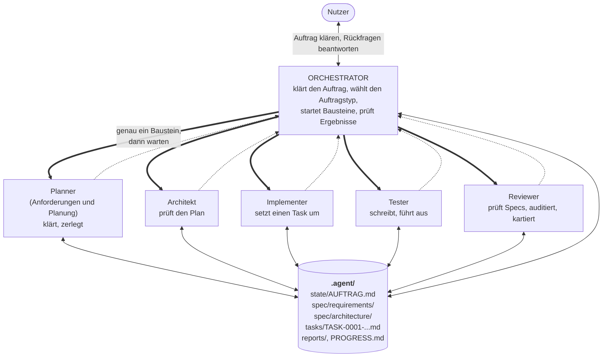
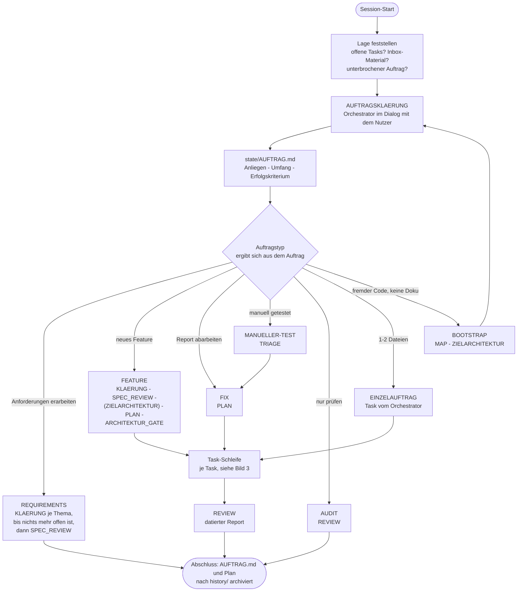
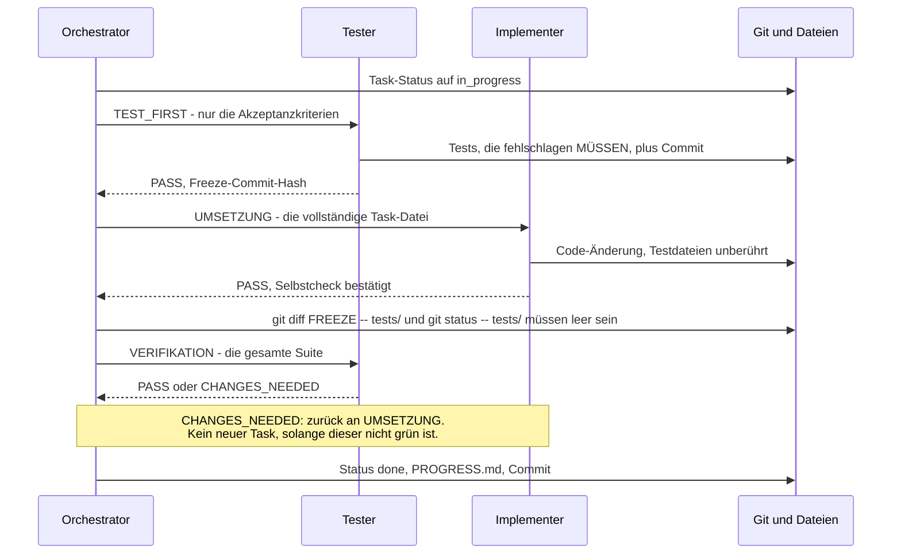

# Agent-Workflow: Rollen-Agenten mit zusammengesetzten Bausteinen

Eine Methode, um ein Software-Vorhaben durch mehrere spezialisierte
Agenten selbständig umsetzen zu lassen, ohne dass Qualität oder
Kontrollierbarkeit leiden – auch (und gerade) wenn einzelne Rollen auf
günstigen oder lokalen Modellen mit begrenztem Kontextfenster laufen.

**Diese Datei erklärt, wie der Workflow funktioniert.** Daneben:

| Datei | Beantwortet |
|---|---|
| `USERMANUAL.md` | Wie richte ich das ein und bediene es? |
| `HARNESS.md` | Welcher Harness kann was, wie laufen Rollen auf anderen Modellen? |
| `DECISIONS.md` | Warum ist es so – und was ist schon schiefgegangen? |
| `project-template/.agent/agents/*.md` | Was eine Rolle **tatsächlich** tut (normativ) |

> Die Rollen-Dateien sind die Quelle der Wahrheit: sie sind der Text, den
> der Agent liest. Dieses Dokument erklärt den Zusammenhang und darf
> deshalb keine Regel in abweichendem Wortlaut wiederholen – im Zweifel
> gilt die Rollen-Datei.

## Das Prinzip in vier Sätzen

1. **Eine Rolle, ein Auftrag, ein frischer Kontext.** Jeder Schritt geht an
   einen neu gestarteten Agenten, der nur seine Auftragsdatei kennt – nie
   die Gesprächshistorie.
2. **Dateien sind das Protokoll.** Rollen reden nie miteinander; sie
   schreiben und lesen Dateien unter `.agent/`. Dadurch überlebt der
   Zustand jeden Abbruch, jeden Modellwechsel und jeden Harness.
3. **Der Orchestrator vermittelt, urteilt aber nicht selbst.** Er klärt den
   Auftrag mit dem Nutzer, wählt die Bausteine, prüft Ergebnisse an Git und
   Dateien – und schreibt selbst keinen Code.
4. **Es gibt keine feste Pipeline.** Aus dem geklärten Auftrag ergibt sich
   ein Auftragstyp, und zu jedem Auftragstyp gehört ein Ablauf – nur eine
   Reihenfolge von Bausteinen.

### Begriffe

| Begriff | Bedeutung | Beispiel |
|---|---|---|
| **Auftrag** | das geklärte Anliegen des Nutzers, festgehalten in `state/AUFTRAG.md` | "Login-Fehler aus dem Review beheben" |
| **Auftragstyp** | die Art der Arbeit, ergibt sich aus dem Auftrag | `FEATURE`, `FIX`, `REQUIREMENTS` |
| **Ablauf** | die feste Bausteinfolge eines Auftragstyps (Teil C) | `PLAN → Task-Schleife → REVIEW` |
| **Baustein** | ein Aufruf genau einer Rolle mit genau einem Auftrag (Teil B) | `TEST_FIRST`, `SPEC_REVIEW` |
| **Verdict** | die Zeile, mit der die Schlussnachricht eines Bausteins beginnt (`Verdict: …`) | `PASS`, `CHANGES_NEEDED` |

Früher hiess der Auftragstyp "Modus"; ältere Texte (`DECISIONS.md`)
verwenden noch dieses Wort.

---

## Überblick in drei Bildern

### Bild 1 – Wer redet mit wem (und wer nicht)



Dicke Pfeile: der Orchestrator startet eine Rolle. Gestrichelt: ihr
Verdict kommt zurück. Dünn: Lesen und Schreiben von Dateien.

Die Pfeile **zwischen** den Rollen fehlen nicht aus Platzgründen: es gibt
sie nicht. Implementer und Tester erfahren nichts voneinander ausser dem,
was in der Task-Datei steht. Genau das macht den Tester unabhängig – er
prüft gegen die Akzeptanzkriterien statt gegen die Absicht des
Implementers.

### Bild 2 – Eine Initiative von vorn bis hinten



Zwei Dinge, die das Bild zeigt und die leicht übersehen werden: die
Auftragsklärung steht **vor** der Wahl des Auftragstyps (nicht umgekehrt), und
`REQUIREMENTS` endet ohne eine Zeile Code – die Umsetzung ist ein eigener,
neu zu klärender Auftrag.

### Bild 3 – Die Task-Schleife mit Test-Freeze



Der Tester kennt beim Schreiben der Tests **nur** die Akzeptanzkriterien,
nicht die spätere Implementierung – und der Implementer darf die Tests
danach nicht mehr anfassen. Das ist strikt stärker als "unabhängiger
Tester im Anschluss": wer den fertigen Code vor sich hat, prüft unbewusst
gegen die Implementierung statt gegen die Spezifikation.

---

## Wann anwenden

- Das Vorhaben lässt sich in klar abgrenzbare, unabhängig testbare
  Arbeitspakete zerlegen (z.B. Module/Funktionen mit klarem
  Ein-/Ausgabeverhalten).
- Es sollen kleine/günstige (ggf. lokale) Modelle verwendet werden
  (begrenztes Kontextfenster, geringere Zuverlässigkeit bei grossen
  Aufgaben am Stück).
- Gilt sowohl für **Greenfield** (neues Projekt, Requirements + Plan werden
  von Null erarbeitet) als auch für **Brownfield** (bestehender Code ohne
  – oder mit veralteter – Doku; Einstieg dafür: `USERMANUAL.md`, Teil 3).

---

## Teil A – Die Rollen

Jede Rolle hat einen bewusst engen, für sich lauffähigen Kontext und eine
eigene Datei unter `.agent/agents/`. Eine Rolle liest **nie** die volle
bisherige Gesprächshistorie – nur das, was ihre Auftragsdatei (ein Task,
ein Report, o.ä.) tatsächlich braucht.

1. **Orchestrator** (`orchestrator.md`) – dünne Schleife, kein grosses
   Kontextfenster nötig. Ermittelt die Ausgangslage, **klärt den Auftrag
   mit dem Nutzer** (Baustein `AUFTRAGSKLAERUNG` → `state/AUFTRAG.md`),
   leitet daraus den **Auftragstyp** ab (Teil C), ruft die Bausteine seines
   **Ablaufs** der Reihe nach auf, wertet deren **Verdict** aus,
   pflegt Task-Status und `state/PROGRESS.md`, committet (pusht nie). Schreibt selbst
   keinen Code und plant selbst keine Schritte. Er ist die **einzige**
   Rolle mit Nutzerkontakt.
2. **Planner** (`planner.md`), Anforderungen und Planung – die
   "Denkarbeit": schärft eine unklare
   Anforderung (Baustein `KLAERUNG`, rundenbasiert über das
   Klärungsprotokoll in `state/AUFTRAG.md`) und zerlegt eine Quelle (neue
   Anforderung oder Findings aus einem Report) in kleine, unabhängige
   `.agent/tasks/TASK-*.md`-Dateien (Baustein `PLAN`). Braucht mehr
   Kontext/Fähigkeit als die Ausführungsrollen – hier lohnt das stärkste
   verfügbare Modell.
3. **Architekt** (`architect.md`) – schlägt die **Zielarchitektur** vor
   (Baustein `ZIELARCHITEKTUR`, der Nutzer entscheidet) und prüft als
   read-only Gutachter den **Plan** gegen Ziel- und Ist-Architektur unter
   `spec/architecture/`, **bevor** Code entsteht: passt das Vorhaben in eine bestehende Abstraktion oder
   braucht es wirklich eine neue? Werden Schichtgrenzen verletzt? Kommt
   eine Abhängigkeit dazu, die es schon gibt? Fängt Architektur-Drift
   dann ab, wenn sie noch nichts kostet.
4. **Implementer** (`implementer.md`) – setzt **genau einen** Task um
   (Code + ggf. minimale Doku/Nachführen der Ist-Architektur), nichts
   darüber hinaus.
   Kennt weder vorherige noch zukünftige Tasks im Detail.
5. **Tester** (`tester.md`) – unabhängig vom Implementer, kennt nur die
   **Akzeptanzkriterien** des Tasks (nicht die Implementierungs-
   Begründung). Läuft in drei Bausteinen: `TEST_FIRST` (schreibt die Tests,
   bevor implementiert wird), `VERIFIKATION` (führt die gesamte Suite
   aus, nachdem implementiert wurde) und – nur nach einem gescheiterten
   Lauf – `GRUEN_PROBE` (Diagnose: Tests erfüllbar? Wie weit ist der
   Teilstand?). Diese Unabhängigkeit ist bewusst:
   sie verhindert, dass Tests nachvollziehen, was sich der Implementer
   gedacht hat, statt echt gegen die Spezifikation zu prüfen.
6. **Reviewer** (`reviewer.md`) – read-only Auditor, editiert nie
   Produktcode/Tests. Vier Bausteine: `MAP` (Bestandsaufnahme eines
   bestehenden Codebestands → `spec/architecture/ist.md`), `SPEC_REVIEW`
   (Requirements auf Vollständigkeit, Widerspruchsfreiheit und
   Prüfbarkeit prüfen → Report mit Befunden), `REVIEW` (Code + Tests gegen
   `spec/` prüfen, inklusive Ist gegen Soll → datierter Report) und `TRIAGE` (Rohmaterial aus
   manuellem Testen in `.agent/inbox/` → Report).
   Erzeugt selbst keine Tasks – das macht der Planner aus dem Report.

Implementer und Tester interagieren **nie direkt** miteinander – jede
Übergabe läuft über den Orchestrator bzw. über die Task-Datei selbst.
Dasselbe gilt für Architekt und Implementer.

### Rollen-Vertrag: einheitlicher Aufbau jeder Rollen-Datei

Jede Datei unter `.agent/agents/` folgt derselben Gliederung. Der Wert
liegt nicht in der Ästhetik, sondern darin, dass eine Rolle beim Lesen
sofort weiss, welcher Abschnitt sie bindet – besonders bei schwächeren
Modellen, die lange Fliesstexte ungleichmässig gewichten.

```markdown
# Rolle: <Name>

<Ein Satz: wer du bist, was dein Ergebnis ist, und was du NICHT tust.>

## Was du liest
<Abschliessende Liste. Alles andere ist ausserhalb deines Auftrags.>

## Vorgehen
<Nummeriert, jeder Punkt eine Handlung – keine Absichtserklärungen.>

## Harte Regeln
<Was du unter keinen Umständen tust. Wo möglich mit konkretem
Anti-Beispiel aus einem realen Vorfall statt abstrakter Regel.>

## Rückmeldung
<Exaktes Ausgabeformat: die Schlussnachricht beginnt wörtlich mit
"Verdict: <WERT>", ohne Formatierung; danach die Pflichtangaben.>
```

Der Body enthält **kein** Frontmatter – er ist harness-neutral
(siehe `HARNESS.md`). Die harness-spezifischen Felder liegen daneben in
`<rolle>.meta.yml`.

### Verdicts: das gemeinsame Rückgabe-Vokabular

Jeder Baustein endet mit **genau einer** Verdict-Zeile: Die
Schlussnachricht beginnt wörtlich mit `Verdict: PASS` (bzw.
`PASS_WITH_NOTES`, `CHANGES_NEEDED`, `BLOCKED`), ohne Formatierung. Der
Orchestrator verzweigt danach mechanisch, statt Fliesstext zu
interpretieren. Das wörtliche Muster ist nötig: lokale Modelle lieferten
das Verdict in 14 Läufen nie als erste Zeile und in wechselnder Form
(`**PASS**`, `## Verdict: PASS`, …). Deshalb steht der Satz in jeder
Rolle **und** am Ende jedes Auftrags, und `run-role.sh` sucht die Zeile
nur in der letzten Antwort des Modells – nicht im ganzen Log, wo auch
Zitiertes stehen kann. Fehlt sie, entscheidet bei vorliegendem
Deliverable die `VERIFIKATION`; ohne Deliverable gilt der Lauf als still
gescheitert.

| Verdict | Bedeutung | Was der Orchestrator tut |
|---|---|---|
| `PASS` | Auftrag erfüllt, nichts anzumerken | Nächster Baustein des Ablaufs |
| `PASS_WITH_NOTES` | Erfüllt, aber mit Hinweisen für nachfolgende Rollen | Weiter; Notizen in die Task-Datei bzw. den Plan übernehmen |
| `CHANGES_NEEDED` | Nicht erfüllt; die Begründung benennt konkret was fehlt | Zurück an die vorgelagerte Rolle, mit der Begründung als zusätzlichem Kontext |
| `BLOCKED` | Kann nicht entscheiden – Information fehlt oder es ist eine Produktentscheidung | Stopp; Rückfrage an den Nutzer, kein Weitermachen auf Verdacht |

Pflicht in jeder Rückmeldung, unabhängig vom Verdict: geänderte Dateien,
und jede bewusst getroffene Annahme oder Abweichung vom Auftrag (mit
Begründung). `CHANGES_NEEDED` und `BLOCKED` ohne konkrete, überprüfbare
Begründung sind selbst ein Fehler und gehen an dieselbe Rolle zurück.

---

## Teil B – Der Baustein-Katalog

Ein **Baustein** ist ein Aufruf genau einer Rolle mit genau einem Auftrag.
Bausteine sind unabhängig voneinander definiert; ein Ablauf (Teil C) ist
nur eine Reihenfolge daraus. Es gibt bewusst **keine feste Pipeline**:
nicht jede Arbeit ist "Anforderung bis Auslieferung", und Bausteine, die
nichts zu tun hätten, werden gar nicht erst gestartet.

| Baustein | Rolle | Aktivierung | Input | Ergebnis |
|---|---|---|---|---|
| `AUFTRAGSKLAERUNG` | Orchestrator | **immer**, als erster Baustein jeder Initiative | Nutzer-Anliegen, Lage im Repo | `state/AUFTRAG.md` + der daraus abgeleitete Auftragstyp |
| `MAP` | Reviewer | Ist-Architektur leer, aber Code existiert | vorhandener Code | `spec/architecture/ist.md` |
| `KLAERUNG` | Planner | Anforderung unklar oder Requirements lückenhaft, oder Befunde aus `SPEC_REVIEW` | `state/AUFTRAG.md`, `spec/`, ggf. Spec-Review-Report | Fragerunde im Klärungsprotokoll **oder** ausformulierte Anforderung unter `spec/requirements/` |
| `SPEC_REVIEW` | Reviewer | einmal pro Initiative, nach der letzten `KLAERUNG` (Ablauf `REQUIREMENTS` und `FEATURE`, Ausnahme siehe Teil C) | `spec/requirements/`, `spec/architecture/ziel.md` | `reports/<datum>-spec-review.md` mit Befunden – keine Fragen |
| `ZIELARCHITEKTUR` | Architekt | nach `MAP`; im Ablauf `FEATURE` vor `PLAN`, wenn `ziel.md` leer ist | Requirements, Ist-Architektur, Code | (a) Vorschlagsrunde im Klärungsprotokoll, (b) nach Nutzerentscheid `spec/architecture/ziel.md` |
| `PLAN` | Planner | immer, ausser bei Einzelauftrag | Anforderung oder Report | `tasks/TASK-*.md` (+ ggf. `state/IMPLEMENTATION_PLAN.md`) |
| `ARCHITEKTUR_GATE` | Architekt | Plan führt neue Komponente/Schnittstelle/Abhängigkeit ein | Task-Set, `spec/architecture/` (Ziel und Ist) | Verdict + Vorgaben für Implementer – nur Schnittstellen und Verantwortungen, nie Code oder Zeilen |
| `TEST_FIRST` | Tester | pro Task, sofern nicht abgewählt | nur Akzeptanzkriterien des Tasks | fehlschlagende Tests + Commit (Freeze-Grenze) |
| `UMSETZUNG` | Implementer | pro Task | vollständige Task-Datei | Code-Änderung |
| `VERIFIKATION` | Tester | pro Task, nach `UMSETZUNG` | Akzeptanzkriterien + Testlauf | Verdict + Test-Notizen in der Task-Datei |
| `GRUEN_PROBE` | Tester | nur nach einem gescheiterten Lauf (Task hat eine Vorgeschichte) | Task-Datei mit Vorgeschichte, Teilstand, Tests | Diagnose + genau eine `Befund:`-Zeile |
| `REVIEW` | Reviewer | nach Abschluss einer Initiative, oder auf Wunsch | `spec/`, Code, Testlauf | `reports/<datum>-review.md` |
| `TRIAGE` | Reviewer | `.agent/inbox/` enthält Material | Inbox-Rohmaterial + Code | `reports/<datum>-triage.md` |

### Auftragsklärung: der einzige Baustein mit Nutzerkontakt

Alle Rollen ausser dem Orchestrator sind Subagenten: einmal gestartet,
eine Rückmeldung, danach weg – sie können den Nutzer weder fragen noch auf
eine Antwort warten. Deshalb liegt das Klären des Auftrags beim
Orchestrator, und sein Ergebnis ist eine **Datei** (`state/AUFTRAG.md`)
statt eines Gesprächsverlaufs:

- Der Auftragstyp wird aus dem geklärten Auftrag abgeleitet, nicht aus dem
  Dateizustand plus einer Chat-Antwort. "Requirements sind leer" heisst
  eben nicht automatisch "bau ein Feature".
- Nachfolgende Rollen lesen den Auftrag, statt ihn als Prosa gereicht zu
  bekommen – konsistent mit "eine Rolle liest nie die Gesprächshistorie".
- Eine unterbrochene Session (Rate-Limit, Absturz, anderer Rechner) kann
  den Auftrag wieder aufnehmen, weil er auf der Platte steht.

Der Baustein ist ein **Filter, kein Interview**: gefragt wird nur, wenn
der Auftragstyp nicht eindeutig ableitbar ist, ein prüfbares
Erfolgskriterium fehlt, der Umfang offen ist oder der Auftrag etwas
Bestehendem widerspricht – dann höchstens fünf Fragen, jede mit
Default-Vorschlag. (Diese Grenze gilt nur für die Auftragsklärung; eine
`KLAERUNG`-Runde des Planners hat ihre eigene, siehe Teil C.)
Fachlich entworfen wird hier nicht; das ist Sache von `KLAERUNG`.

Die beiden Klärungen sind bewusst getrennt:

| Baustein | Rolle | Klärt | Ergebnis |
|---|---|---|---|
| `AUFTRAGSKLAERUNG` | Orchestrator (im Dialog) | *Was für Arbeit, welcher Umfang?* | `state/AUFTRAG.md` + Auftragstyp |
| `KLAERUNG` | Planner (Subagent, je Runde ein Aufruf) | *Ist diese Anforderung planbar?* | Fragen bzw. Anforderung unter `spec/requirements/` |

### `SPEC_REVIEW`: ein unabhängiges Auge auf die Anforderungen

Lücken in den Anforderungen fallen sonst erst während der Umsetzung auf –
beim Tester, beim Architekten oder als Neuschnitt durch den Planner, also
dann, wenn sie am teuersten sind. Der Planner hat die Anforderungen selbst
ausformuliert; seine Prüfung wäre eine Selbstauskunft, und Selbstauskunft
wird in diesem Workflow nicht geglaubt. Deshalb prüft der Reviewer
die Requirements (`spec/requirements/`) einmal pro Initiative auf:

- **Prüfbarkeit**: jede Anforderung hat ein prüfbares Kriterium,
- **Vollständigkeit**: alle sichtbaren Texte sind festgelegt, das
  Fehlerverhalten ist für jede Aktion festgelegt,
- **Widerspruchsfreiheit**: untereinander und gegenüber
  der Zielarchitektur (`spec/architecture/ziel.md`).

Er liefert **Befunde, keine Fragen**. Daraus formuliert der Planner in
einer zusätzlichen `KLAERUNG`-Runde die Fragen an den Nutzer, je mit
Vorschlag als Default – der Reviewer kennt den Nutzer nicht, der Planner
kennt das Klärungsprotokoll. Einmal pro Initiative heisst: nach dieser
Fragerunde folgt kein zweiter `SPEC_REVIEW`, die Schleife ist begrenzt.

### Zielarchitektur und Ist-Architektur

Die Architektur hat zwei Sichten mit verschiedenen Besitzern:

| | Zielarchitektur (top-down, `ziel.md`) | Ist-Architektur (bottom-up, `ist.md`) |
|---|---|---|
| Inhalt | Systemkontext, Bausteine/Schichten, Architekturregeln, Entscheidungen, Qualitätsziele | Komponenten wie heute im Code: Zuständigkeit, Schnittstelle, Abhängigkeiten, Invarianten |
| Wer schreibt | Architekt schlägt vor, der **Nutzer entscheidet** | Reviewer (`MAP`), danach der Implementer je Task |
| ändert sich | nur durch bewussten Entscheid | mit jedem Task, der einen Vertrag ändert |

Das `ARCHITEKTUR_GATE` misst einen Plan am Soll, der `REVIEW` das Ist am
Soll; jede Abweichung ist ein Finding, ausser sie steht als bewusst
akzeptierte Lücke in `abweichungen.md`. Ohne Zielarchitektur gäbe es nur
die Beschreibung dessen, was zufällig entstanden ist – Gate und Review
hätten keinen Massstab.

### Aktivierung: mechanisch, wo es geht

Ein Baustein wird nicht nach Gefühl gestartet, sondern nach einer
überprüfbaren Bedingung. Wo eine Bedingung mechanisch prüfbar ist, prüft
der Orchestrator sie per Kommando statt sie einzuschätzen:

```bash
# Liegt Rohmaterial zum Triagieren vor?
ls -A .agent/inbox/ | grep -v -e '^processed$' -e '^\.gitkeep$'

# Wurde eine Abhängigkeits-Manifestdatei angefasst?  → ARCHITEKTUR_GATE
git diff --name-only -- pyproject.toml requirements.txt package.json go.mod

# Welche Prüf-Linsen braucht der Review überhaupt?
git diff --name-only origin/main...HEAD
```

**Kein Baustein wird gestartet, dessen Ergebnis absehbar "nichts zu tun"
wäre.** Ein übersprungener Baustein wird aber in `state/PROGRESS.md`
protokolliert – mit der Bedingung, die zum Überspringen führte, damit
später nachvollziehbar ist, dass er nicht vergessen wurde:

```
SKIPPED ARCHITEKTUR_GATE – keine neue Komponente/Abhängigkeit im Plan
(mechanisch geprüft: kein Manifest im Diff)
```

### Prüf-Linsen statt Spezial-Reviewer

Statt eigener Agenten für Sicherheit, Abhängigkeiten, UI usw. bekommt der
eine Reviewer **Linsen**, die der Orchestrator anhand des Diffs aktiviert
(z.B. Sicherheits-Linse bei Krypto-/Auth-/Eingabe-Validierungs-Code,
Abhängigkeits-Linse bei geänderten Manifesten). Das hält die Zahl der
Rollen-Dateien klein und die Aktivierungsentscheidung mechanisch.

---

## Teil C – Auftragstypen und ihre Abläufe

Der Orchestrator ermittelt zu Beginn jeder Session die Ausgangslage, klärt
den Auftrag und leitet daraus den Auftragstyp ab. Zu jedem Auftragstyp
gehört ein Ablauf, und ein Ablauf ist nichts weiter als eine Reihenfolge
von Bausteinen.

Jede Initiative beginnt mit `AUFTRAGSKLAERUNG`; der Auftragstyp ist das
Ergebnis dieses Bausteins und steht in `state/AUFTRAG.md`. Ein Auftrag
ergibt genau einen Auftragstyp – fällt unterwegs etwas an, das einen
anderen bräuchte, wird das ein eigener Auftrag, kein Anhängsel.

**Ausnahme: Einschub-Tasks.** Ein kleiner Task darf in den laufenden
Auftrag eingeschoben werden, wenn alle drei Bedingungen gelten: er hat
dieselbe Quelle bzw. dasselbe Ziel wie der laufende Auftrag, er ist
höchstens so gross wie ein `EINZELAUFTRAG`, und er braucht keine neue
fachliche Klärung. Er bekommt eine Teil-Task-ID an der passenden Stelle
der Reihenfolge und je eine Zeile "Einschub: <Task>, <Grund>" in
`state/AUFTRAG.md` und `state/PROGRESS.md`. Alles andere wird weiterhin
notiert und ein eigener Auftrag.

```
BOOTSTRAP (Brownfield, erstmalig)
  MAP → ZIELARCHITEKTUR(a: Vorschlag) → Nutzer entscheidet
      → ZIELARCHITEKTUR(b: in ziel.md übernehmen)
  → danach neue AUFTRAGSKLAERUNG (meist REQUIREMENTS oder AUDIT)

REQUIREMENTS (Anforderungen erarbeiten – Deliverable ist spec/requirements/)
  je Thema: KLAERUNG(a: Fragerunde) → Nutzer antwortet (Orchestrator)
          → KLAERUNG(b: Ausformulierung)
  bis der Planner "keine offenen Themen" meldet
  → SPEC_REVIEW → bei Befunden: eine KLAERUNG-Runde (a + b) dazu
  (kein PLAN, keine Tasks, kein Code – die Umsetzung ist ein neuer Auftrag)

FEATURE (neue Anforderung umsetzen)
  KLAERUNG → SPEC_REVIEW → bei Befunden: eine KLAERUNG-Runde dazu
           → ZIELARCHITEKTUR (a, b) – nur wenn ziel.md noch leer ist
           → PLAN → ARCHITEKTUR_GATE
           → [ TEST_FIRST → UMSETZUNG → VERIFIKATION ] pro Task
           → REVIEW
  (SPEC_REVIEW entfällt, wenn die Requirements unverändert aus einem
   REQUIREMENTS-Auftrag mit SPEC_REVIEW stammen – mechanisch per git diff
   seit dessen Abschluss geprüft)

FIX (Findings aus einem Report beheben)
  PLAN → [ TEST_FIRST → UMSETZUNG → VERIFIKATION ] pro Task
       → REVIEW
  (kein KLAERUNG, kein Plan-Dokument – der Report ist die Quelle)

AUDIT (Zustand prüfen, nichts ändern)
  REVIEW

MANUELLER-TEST (Nutzer hat getestet, Material liegt in der Inbox)
  TRIAGE → danach FIX

EINZELAUFTRAG (kleine, klar umrissene Änderung)
  UMSETZUNG → VERIFIKATION
  (kein Planner; der Orchestrator legt die Task-Datei selbst an.
   Zulässig nur, wenn der Auftrag 1–2 Dateien betrifft und prüfbare
   Akzeptanzkriterien hat – sonst ist es ein FIX oder FEATURE.)
```

### Die Klärungsschleife des Auftragstyps `REQUIREMENTS`

Der Planner kann den Nutzer nicht fragen und erinnert sich zwischen zwei
Aufrufen an nichts. Trotzdem ist ein mehrrundiges, thematisch geordnetes
Erarbeiten von Anforderungen möglich – weil der Orchestrator das Gespräch
führt und der **Zustand in der Datei liegt**, nicht im Kontext eines
Agenten:

1. `KLAERUNG` (a): Planner wählt **ein** Thema und schreibt höchstens
   sieben Fragen pro Runde – je mit Begründung und Default-Vorschlag – als
   neue Runde ins Klärungsprotokoll von `state/AUFTRAG.md`. Die Grenze
   steht in `planner.md`; der Orchestrator gibt im Auftrag keine eigene
   Fragenzahl vor.
2. Der Orchestrator stellt sie dem Nutzer wörtlich und trägt die Antworten
   in dieselbe Runde ein.
3. `KLAERUNG` (b): ein **frischer** Planner liest das Protokoll,
   formuliert das Thema unter `spec/requirements/` aus und meldet als
   letzte Zeile `nächstes Thema: <…>` oder `keine offenen Themen`.
4. Der Orchestrator verzweigt daran: weitere Runde oder fertig. Nach fünf
   Runden ohne Abschluss stoppt er und fragt den Nutzer – eine Klärung,
   die nicht konvergiert, ist ein zu gross geschnittener Auftrag.
5. Meldet der Planner "keine offenen Themen": `SPEC_REVIEW`. Liefert er
   Befunde, folgt genau eine weitere Runde (a) + (b), in der der Planner
   die Befunde zu Fragen macht; danach ist die Schleife fertig.

Dasselbe Muster trägt überall dort, wo ein kontextfreier Subagent etwas
"Interaktives" beitragen soll: nicht die Rolle interaktiv machen, sondern
den Zustand aus dem Agenten in eine Datei verlagern und den Orchestrator
die Runden takten lassen.

### Nicht verhandelbare Grundregel: strikt sequentiell, nie parallel

Unabhängig vom Auftragstyp gilt: Zu jedem Zeitpunkt ist genau **ein** Baustein
aktiv und genau **ein** Task "in Arbeit". Der nächste Task wird nicht
einmal geplant, solange der aktuelle nicht verifiziert und auf `done`
gesetzt ist. Jeder Baustein geht an einen **frischen Agenten** (echter
Aufruf, nicht "im Kontext weiterdenken"); der Orchestrator wartet auf die
vollständige Rückmeldung, bevor irgendetwas anderes passiert.

Begründung und der reale Vorfall, der zu dieser Regel führte: siehe
`DECISIONS.md`, Lehre Nr. 7.

**Erprobt, aber (noch) nicht Teil der Methodik: parallele Bahnen.** In
Messexperimenten (pwd-transform, 2026-10) liefen Tasks testweise in zwei
Bahnen parallel, mit eigenen Regeln: Tasks mit Änderungen unter `tests/`
in eine Bahn (gemeinsame Suite und Freeze-Prüfung), gleiche Datei →
gleiche Bahn, Doku erst nach Übernahme der Code-Tasks, eigenes
Arbeitsverzeichnis je Bahn, `HALTED` gilt für alle Bahnen. Die
Grundregel bleibt bis zur Auswertung bestehen; erst wenn sich zeigt, dass
Bahnen netto mehr bringen, als Zusammenführen und Prüfen kosten, kommen
sie als optionaler Betriebsmodus dazu (dann je Bahn ein eigener Klon bzw.
`git worktree` mit eigenem Branch).

### Start jeder Session

1. **Lage ermitteln** – mechanisch, nicht aus dem Gedächtnis:
   `spec/architecture/ist.md` (leer, aber Code vorhanden?), `ziel.md`
   (leer?), `.agent/tasks/*.md`
   nach `status: open`/`in_progress`, `.agent/inbox/` auf Material,
   `state/AUFTRAG.md` auf einen unterbrochenen Lauf.
   - Offene Tasks → dem Nutzer melden (Anzahl, Titel), fragen ob
     fortgesetzt werden soll oder etwas Neues Vorrang hat.
   - Material in der Inbox (auch zusätzlich zu offenen Tasks) → melden,
     fragen ob jetzt triagiert werden soll.
   - Gefülltes `AUFTRAG.md` mit unerledigter Arbeit → dort weitermachen
     statt neu zu klären.
2. **`AUFTRAGSKLAERUNG`** – immer, auch wenn der Nutzer schon gesagt hat,
   was er will. Ergebnis: `state/AUFTRAG.md`.
3. **Auftragstyp ableiten** aus `state/AUFTRAG.md`, die Bausteine seines
   Ablaufs der Reihe nach abarbeiten, nach jedem Baustein das Verdict auswerten.
4. **Abschluss**: `state/AUFTRAG.md` (und, falls befüllt,
   `state/IMPLEMENTATION_PLAN.md`) nach `history/` archivieren und auf die
   leere Vorlage zurücksetzen.

### Task-Schleife im Detail

1. Nächsten Task ermitteln: `status: open`, alle Einträge in `depends_on`
   bereits `done`. Bei mehreren wählbaren Tasks: niedrigste ID zuerst.
2. Status auf `in_progress` setzen.
3. `TEST_FIRST` → `UMSETZUNG` → `VERIFIKATION` (Test-Freeze: Teil D).
4. Bei `CHANGES_NEEDED` aus der Verifikation: erneut `UMSETZUNG` für
   denselben Task, mit den fehlgeschlagenen Tests/Fehlermeldungen als
   zusätzlichem Kontext. Zurück zu `VERIFIKATION`. **Kein neuer Task
   beginnt, solange dieser nicht grün ist.**
5. Bei `PASS`: Status auf `done`, Test-Notizen in der Task-Datei, eine
   Zeile an `state/PROGRESS.md`, Git-Commit (Task-ID + Titel) auf dem
   Branch des Auftrags.
6. Keine offenen Tasks der Initiative mehr: `state/IMPLEMENTATION_PLAN.md`
   (falls befüllt) nach `history/<datum>-<slug>-plan.md` archivieren und
   zurücksetzen, Zusammenfassung an den Nutzer.

### Git: der Agent committet, nur der Nutzer pusht

Jeder Auftrag, der Dateien ändert, läuft auf einem eigenen Branch
`agent/<slug>`. Der Orchestrator committet nach jedem Baustein, der etwas
geändert hat, und nach jedem verifizierten Task; der Tester committet die
Freeze-Grenze. Das hat drei Gründe: Die Freeze-Grenze ist ein echter
Commit statt eines Datei-Snapshots; geht ein Lauf schief, ist höchstens
ein Baustein verloren; und `git diff` zeigt einer Rolle nur, was seit dem
letzten Baustein passiert ist – nicht die Änderungen aller Vortasks, die
ein kleines Modell beim Selbst-Check verwirren.

**Gepusht wird nie vom Agenten.** Er bekommt keine Zugangsdaten; der
Nutzer holt den Branch per `git fetch` in seine eigene Arbeitskopie (auch
während der Agent arbeitet), pusht von dort und mergt per PR – Git im Klon
des Agenten aufzurufen wäre unsicher, weil der Agent dort Hooks ablegen
kann, die mit den Rechten des Nutzers liefen. In der Sandbox heisst das: eigener Klon nur für den
Agenten, gestartet mit `run-sandbox.sh --git-rw` (Details:
`sandbox/README.md`, "Commit-Flow").

### Scheitern: erst diagnostizieren, dann reagieren

**Grundsatz: gründlich prüfen erst, wenn etwas schiefging.** Im Normalfall
wird nicht mehr geprüft als nötig. Hat eine Task-Datei aber eine
Vorgeschichte, schauen die Rollen genauer hin: der Tester mit der
Grün-Probe, der Planner schneidet beim Neuschnitt entlang der Stelle, an
der es scheiterte, und der Architekt prüft eine Gate-Vorgabe erneut, an
der ein Lauf gescheitert ist. So zahlt nur der problematische Task die
Kosten der Diagnose.

Ein Timeout hat sehr verschiedene Ursachen, und jede braucht eine andere
Reaktion. Die **Grün-Probe** (`GRUEN_PROBE`) des Testers klärt zwei Fragen:
Sind die eingefrorenen Tests überhaupt erfüllbar (per
Wegwerf-Implementierung ausserhalb des Repos, die nicht weitergegeben
wird)? Und wie weit ist der hinterlassene Stand? Der Tester urteilt, der
Orchestrator ordnet nach einer festen Regel zu:

| Befund | Reaktion |
|---|---|
| `VOLLSTAENDIG` | Grün-Probe zählt als Verifikation, Task `done` |
| `TEST_UNERFUELLBAR` | Nutzer entscheidet, dann derselbe Task mit korrigiertem Test |
| `FAST_FERTIG` | nächster Versuch auf dem Teilstand, mit Korrekturliste |
| `ZU_GROSS` | Neuschnitt in Teil-Tasks |
| `ZU_VIEL_LESESTOFF` | Wegweiser auf die Fundstellen, danach grösseres Modell; immer ein Strukturbefund ("Datei aufteilen") |

Neu geschnitten oder das Modell gewechselt wird nur vor der
Versuchsgrenze; ist die Initiative angehalten (`HALTED`), entscheidet der
Nutzer. Welcher Abbruchgrund des Wrappers welche Reaktion auslöst
(Setup-Fehler, Timeout, abgelehnte Berechtigung), steht als Tabelle in
`orchestrator.md`, Schritt 5.

### Delta-fokussierte Wiederholungen

Wird ein Baustein nach einer Korrektur erneut gestartet, bekommt er den
Commit-Hash seines vorherigen Verdicts mit und prüft **nur die Commits
seither** – nicht den gesamten Stand von vorn. Das hält wiederholte
Review-Runden bezahlbar und den Kontext klein genug für kleine Modelle.

---

## Teil D – Mechanische Härtung

Leitsatz: **Eine Prosa-Regel ist die letzte Wahl, nicht die erste.** Wo der
Harness oder ein Kommando dieselbe Zusage erzwingen kann, wird sie so
erzwungen. Bei kleinen/lokalen Modellen ist das kein Feinschliff, sondern
der Unterschied zwischen "hält" und "hält meistens".

| Zusage | Mechanisch durch | Prosa nur als Ergänzung |
|---|---|---|
| Reviewer/Architekt schreiben nur ihre eigenen Dateien (Reports, Ist- bzw. Zielarchitektur, Gate-Vorgaben) | `path_allows` → OpenCode `permission.edit`; in Claude Code Regel im Prompt + Diff-Prüfung | "du editierst nie Produktcode und Tests" |
| Implementer fasst keine Tests an | OpenCode `edit: { "tests/**": deny }`; Claude Code `PreToolUse`-Hook; zusätzlich Diff-Prüfung durch den Orchestrator | "du editierst nie Testcode" |
| Frischer Kontext je Baustein | eigener Agenten-/Session-Aufruf | "lies nicht die Historie" |
| Kein Endlos-Lauf | `max_steps` / `steps` / `maxTurns`, `timeout` um den Unterprozess | – |
| Baustein nur wenn nötig | `git diff --name-only`-Bedingung | – |
| Task wirklich erledigt | Diff + Task-Datei prüfen, nicht der Selbstauskunft glauben | Selbst-Check-Liste in der Rollen-Datei |

### Test-Freeze

Die Tests eines Tasks entstehen **vor** seiner Implementierung und werden
danach eingefroren:

1. `TEST_FIRST`: Der Tester schreibt aus den Akzeptanzkriterien Tests, die
   **fehlschlagen müssen** (schlägt keiner fehl, prüft der Test entweder
   nichts oder das Verhalten existiert schon → `CHANGES_NEEDED` bzw.
   `BLOCKED`). Eigener Commit; dessen Hash ist die Freeze-Grenze.
2. `UMSETZUNG`: Der Implementer macht sie grün, ohne Testdateien
   anzufassen.
3. Der Orchestrator prüft das mechanisch – gegen den Arbeitsbaum, weil
   der Implementer nicht committet:
   ```bash
   git diff <freeze-commit> --name-only -- tests/
   git status --porcelain -- tests/
   ```
   Gibt das etwas aus, werden diese Änderungen verworfen und der
   Implementer bekommt den Verstoss als Kontext zurück.
4. `VERIFIKATION`: Der Tester führt die **gesamte** Suite aus – ein Task ist
   erst grün, wenn nichts anderes kaputtgegangen ist.

Das ist strikt stärker als "unabhängiger Tester im Anschluss": ein Tester,
der den fertigen Code vor sich hat, kann unbewusst gegen die
Implementierung statt gegen die Spezifikation prüfen.

**Ausnahme**, in der Task-Datei explizit zu markieren (`test_first: false`
plus Begründung): Tasks ohne prüfbares Verhalten – reine Doku-Änderungen,
Umbenennungen ohne Verhaltensänderung, Build-/Konfigurationsarbeit. Wer
die Ausnahme wählt, begründet sie in der Task-Datei; stillschweigend
weggelassen wird sie nie.

---

## Teil E – Dateistruktur (pro Projekt)

```
AGENTS.md                        # Projekt-Root, @-importiert agents/orchestrator.md
CLAUDE.md                        # Projekt-Root, @-importiert AGENTS.md

.agent/
  spec/                          # dauerhaftes Produktwissen – relevant
                                 # unabhängig von diesem Workflow
    requirements/                # funktionale Anforderungen, ändern sich selten
      README.md                  # Index: Kontext, Nicht-Ziele, Stufen, Kapitelliste
      <bereich>.md               # je Bereich ein Kapitel
    architecture/
      README.md                  # Index: welche Sicht steht wo
      ziel.md                    # Soll (top-down), Nutzer entscheidet
      ist.md                     # Ist (bottom-up), je Task nachgeführt
      abweichungen.md            # bewusst akzeptierte Lücke Soll ↔ Ist
      komponenten/<name>.md      # ausgelagerte Kapitel, erst bei Bedarf

  state/                         # veränderlicher Workflow-Zustand (SCREAMING_SNAKE)
    AUFTRAG.md                   # NUR das aktuell geklärte Anliegen samt
                                 # Klärungsprotokoll; leer, wenn nichts läuft
    IMPLEMENTATION_PLAN.md       # NUR die aktiv laufende Initiative; leer,
                                 # wenn gerade nichts läuft
    PROGRESS.md                  # Append-only chronologisches Log
    MEMORY.md                    # projektspezifische Notizen über Sessions hinweg

  sync-agents.py                 # Generator: neutrale Quelle → Adapter
  run-role.sh                    # einziger Weg, eine Rolle in OpenCode zu starten
  vorflug.sh                     # Modell-Server bereit? (Kontext, GPU-Anteil)
  monitor.sh                     # laufenden Baustein beobachten
  export.sh                      # Messdaten sichern (vor Compact, bei Abschluss)

  agents/                        # eine Datei pro Rolle (lowercase), harness-neutral
    _tiers.yml                   # model_tier → konkretes Modell, je Harness
    orchestrator.md / orchestrator.meta.yml
    planner.md / planner.meta.yml
    architect.md / architect.meta.yml
    implementer.md / implementer.meta.yml
    tester.md / tester.meta.yml
    reviewer.md / reviewer.meta.yml

  tasks/                         # die atomare, planbare Warteschlange (lowercase)
    TEMPLATE.md
    TASK-0001-<slug>.md

  reports/                       # datierte, read-only Review-Ausgaben
    2026-08-30-review.md

  inbox/                         # unstrukturiertes Rohmaterial aus manuellem Testen
    processed/<datum>/           # nach der Triage hierhin verschoben

  runs/                          # Logs fremder Harness-Läufe (nicht committen)
    TASK-0007-implementer-a1.log # <task>-<rolle>-a<versuch>.log
    metrics.jsonl                # Messdaten je Lauf

  history/                       # Archiv abgeschlossener Aufträge/Pläne
    2026-08-15-initial-build-auftrag.md
    2026-08-15-initial-build-plan.md

.claude/agents/                  # generierte Adapter – nicht von Hand editieren
.opencode/agent/                 # generierte Adapter – nicht von Hand editieren
```

Die Schreibweise ist bewusst: `SCREAMING_SNAKE` = einzelner, mutierbarer
Zustand, `lowercase` = viele gleichartige Instanzen (Rollen, Tasks,
Reports, Spec-Kapitel). Wer eine Datei sieht, weiss am Namen, in welche
Kategorie sie gehört.

**Warum `spec/` aus Ordnern mit Index besteht:** Eine Rolle mit kleinem
Kontext liest den Index und genau die Kapitel, die ihr Auftrag berührt –
nicht eine 130-KB-Datei. Wird ein Kapitel grösser als etwa 30 KB (rund
ein Viertel eines 64k-Kontexts), wird sein grösster eigenständiger Teil
ausgelagert und im Index eingetragen. Der Orchestrator prüft das beim
Abschluss jeder Initiative mechanisch (`find .agent/spec -size +30k`) und
schlägt das Aufteilen als eigenen Auftrag vor.

### Task-Datei-Format (`.agent/tasks/TASK-####-<slug>.md`)

Die Task-Datei ist die einzige Information, die eine ausführende Rolle
zusätzlich zum bestehenden Code braucht – und gleichzeitig das Protokoll
zwischen Runtimes. Sie muss deshalb **vollständig in sich geschlossen**
sein.

```markdown

---

id: TASK-0023
title: <kurzer, imperativer Titel>
status: open            # open | in_progress | done | failed | blocked | superseded
superseded_by: []       # nur bei superseded: die ersetzenden Task-IDs
source: plan-step       # plan-step | review-finding | triage-finding | auftrag
source_ref: state/IMPLEMENTATION_PLAN.md#schritt-6
depends_on: []          # andere Task-IDs, die vorher done sein müssen
files: [pfad/zur/datei.py]

runtime:                # leer = Rolle entscheidet | subagent | opencode
model:                  # leer = Rolle entscheidet; nur für Sonderfälle
test_first: true        # false nur mit Begründung im Kontext-Abschnitt

---

## Deliverable
<konkret: max. 1-2 Dateien/Module>

## Akzeptanzkriterien
- <prüfbare Bedingung 1>
- <prüfbare Bedingung 2>

## Kontext
<Niveau "Auftrag für einen normalen Entwickler": Quellen, bindende
Schnittstellen, Wegweiser auf Komponenten (aus ist.md) bzw. auf die
Kapiteldatei einer grossen Spec-Datei – kein fertiger Code, keine
Zeilennummern, nicht die Konversationshistorie>

## Vorgeschichte
<normalerweise leer; nach einem gescheiterten Lauf vom Orchestrator
ergänzt: Versuch, Rolle, Ausgang, was erreicht/offen war, Log-Verweis>

## Vorgaben aus dem Architektur-Gate
<vom Architekten befüllt, falls der Baustein lief: welche bestehende
Abstraktion zu nutzen ist, welche Grenzen gelten>

## Test-Notizen
<vom Tester befüllt: welche Tests geschrieben/ausgeführt, Ergebnis,
Freeze-Commit-Hash>
```

### Regeln für die Task-Grösse

- Ein Task betrifft max. 1–2 Dateien/Module und **eine
  Verhaltensfacette**. Ist er grösser, wird er vom Planner weiter
  unterteilt statt in einem Rutsch vergeben.
- **Niveau: ein Auftrag für einen normalen Entwickler** – Ziel,
  Akzeptanzkriterien mit konkreten Werten, bindende Schnittstellen,
  Quellen, Wegweiser auf Komponentenebene. Kein fertiger Code, keine
  Ersetzungszeilen, keine vorformulierte Doku: Wer die Arbeit in die
  Task-Datei schreibt, leistet sie vorab und verfälscht, was die
  ausführende Rolle (und ein Modellvergleich) eigentlich zeigen soll.
- **Die Ist-Architektur ist die Landkarte.** Muss der Planner in den Code
  schauen, um die zuständige Stelle überhaupt zu finden, ist das ein
  Befund über `ist.md`, kein Anlass für Zeilennummern. Beschreibt `ist.md`
  den heutigen Code falsch, wird das vor den Code-Tasks korrigiert.
- Ändert ein Task einen Vertrag, steht `ist.md` in seinem `files:`; der
  Implementer zieht den Eintrag im selben Task nach – separate
  Doku-Nachzug-Tasks gibt es dafür nicht.
- "Überall X ersetzen"-Tasks haben nie grep als einziges
  Akzeptanzkriterium; der eigentliche Test ist die Durchsicht Wort für
  Wort.
- Ein Task muss ohne Kenntnis anderer Tasks umsetzbar sein – Ausnahme:
  `depends_on` macht eine unvermeidbare Reihenfolge explizit.
- Jeder Task hat konkrete, prüfbare Akzeptanzkriterien (keine vagen
  Beschreibungen wie "funktioniert gut").
- Jeder Task lässt das Repo lauffähig und grün zurück.
- Scheitert ein Lauf (Timeout, ohne Ergebnis): nicht denselben Auftrag
  erneut starten und hoffen, sondern erst diagnostizieren – siehe
  "Scheitern: erst diagnostizieren, dann reagieren" (Teil C).
- Abhängigkeiten von externer Hardware/Diensten werden vermieden bzw.
  gemockt; Sonderfälle werden eigene, spätere Tasks.

### Lebenszyklus einer Task-Datei, wenn es nicht glatt läuft

- **Vorgeschichte**: Jede Rolle startet ohne Gedächtnis. Scheitert ein
  Lauf, trägt der Orchestrator in der Task-Datei ein, was passiert ist –
  der nächste Versuch (und jede Diagnose) liest es dort.
- **`superseded`**: Wird ein bereits begonnener Task neu geschnitten,
  bleibt seine Datei als Beleg liegen, mit `status: superseded` und
  `superseded_by` auf die Nachfolger. Ein `depends_on` auf ihn gilt als
  erfüllt, sobald alle Nachfolger `done` sind – sonst blockierte ein
  Neuschnitt alle Folgetasks. Noch nie begonnene Tasks werden dagegen
  einfach überarbeitet; der Commit ist Beleg genug.
- **Teil-IDs** `TASK-####.N`: für die Teile eines Neuschnitts und für
  Tasks, die nachträglich an einer bestimmten Stelle der Reihenfolge
  stehen müssen (auch Einschub-Tasks). Sortiert wird numerisch je Stufe:
  `0037` < `0037.1` < `0037.2` < `0038`.
- **Neuschnitt**: eine Verhaltensfacette pro Teil-Task; bereits
  eingefrorene Tests werden wörtlich auf die Teile verteilt und per
  `git diff <freeze-commit>` als unverändert belegt.
- **Zurückgestellte Findings**: Was aus einem Report bewusst nicht
  behoben wurde, landet beim Abschluss der Initiative in
  `state/MEMORY.md`; der Orchestrator fragt bei der nächsten Umsetzung,
  ob es mitkommt.

---

## Weiterführend

- **Rollen auf anderen Modellen oder in einem anderen Harness laufen
  lassen** – die verifizierte Harness-Matrix, der Generator
  (`sync-agents.py`), `meta.yml`/`_tiers.yml` und der Aufruf eines fremden
  Harness als Unterprozess: `HARNESS.md`.
- **Einrichten, Arbeit anstossen, Fehlerbilder**: `USERMANUAL.md`.
- **Warum eine Regel existiert und was sie verhindert**: `DECISIONS.md` –
  dort steht zu jeder harten Regel der Vorfall, aus dem sie entstanden ist.
