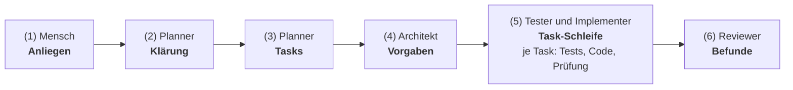
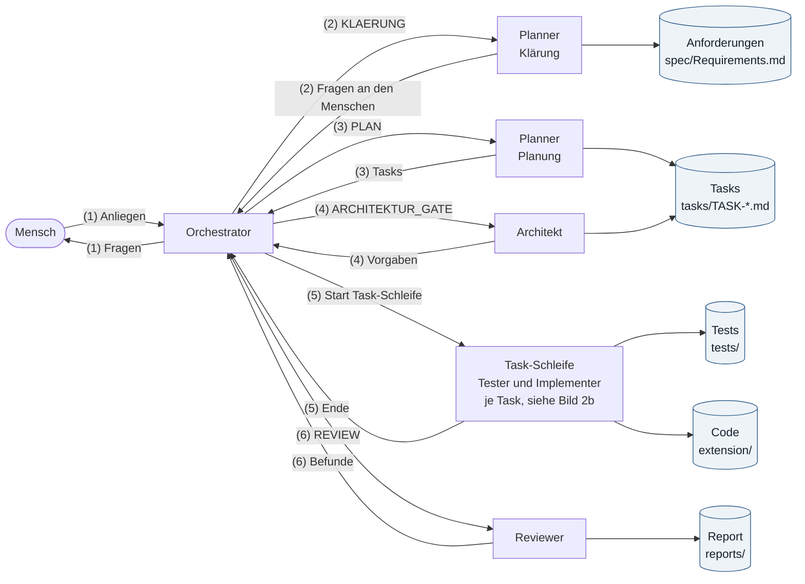
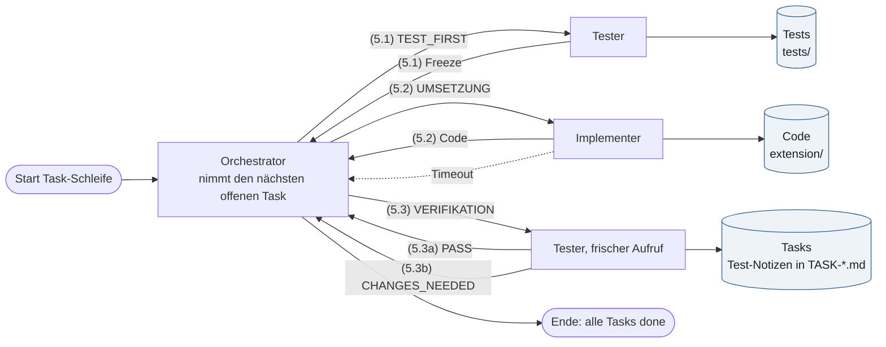
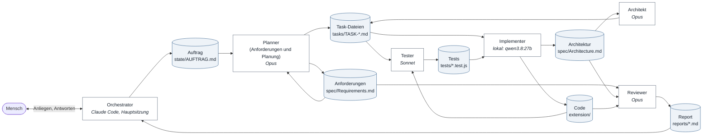
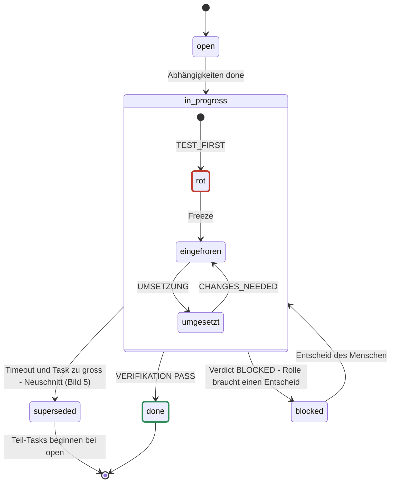
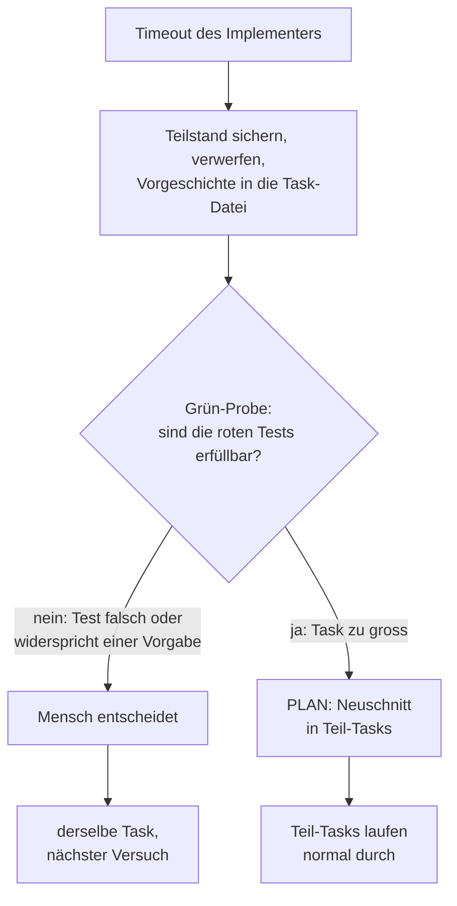
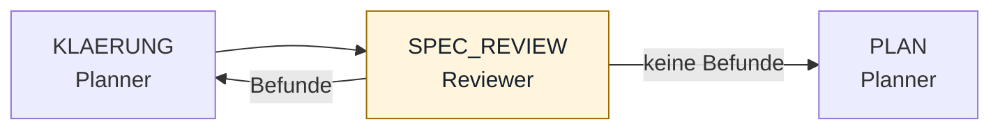

# Teil A – Der Workflow: Softwareentwicklung mit spezialisierten Agenten

> **Entwurf, Stand 2026-10-03.** Teil A beschreibt das Vorgehen und gilt
> unabhängig davon, welches Modell welche Rolle ausführt. Ob die Umsetzung
> in der Cloud oder lokal läuft, ist ein Experiment auf diesem Vorgehen;
> Verlauf und Messungen dazu stehen in
> [Teil B](2026-09-30-bericht-teil-b-verlauf.md).
> Methodik im Detail: `tools/agent-workflow/AGENT_WORKFLOW.md`.

## Die Idee in fünf Sätzen

1. Ein **Orchestrator** spricht als einzige Rolle mit dem Menschen. Er klärt
   den Auftrag, legt ihn als Datei ab und bestimmt daraus den
   **Auftragstyp** und damit den Ablauf.
2. Jede weitere Rolle (**Planner, Architekt, Tester, Implementer, Reviewer**)
   ist ein frischer Agent ohne Gesprächsgedächtnis. Sie liest nur Dateien,
   schreibt nur Dateien und meldet mit einem **Verdict** zurück.
3. Arbeit wird in **kleine Tasks** geschnitten, meist eine Produktdatei und
   eine Testdatei pro Task. Die Task-Datei trägt den ganzen Zustand
   zwischen den Rollen.
4. **Tests entstehen vor dem Code** und werden danach eingefroren. Der
   Implementer darf sie nicht ändern, ein unabhängiger Tester prüft gegen
   sie.
5. **Strikt sequentiell:** Es ist immer genau ein Baustein aktiv. Ein Task
   ist erst fertig, wenn ein Tester ihn verifiziert hat.

## Bild 1 – Beispielablauf

Ein Auftrag vom Typ `FEATURE` von Anfang bis Ende, auf einen Blick. Jeder
Block ist ein Schritt mit der Rolle, die ihn ausführt, und dem, was dabei
entsteht. Die Nummern sind dieselben wie in Bild 2a und 2b, die die Schritte im
Detail zeigen.

| Schritt | Wer | Was entsteht |
|---|---|---|
| (1) Anliegen | Mensch, mit dem Orchestrator | Der geklärte Auftrag in `state/AUFTRAG.md` |
| (2) Klärung | Planner | Fragen an den Menschen, daraus die Anforderungen in `spec/Requirements.md` |
| (3) Tasks | Planner | Kleine Task-Dateien mit Akzeptanzkriterien |
| (4) Vorgaben | Architekt | Bindende Vorgaben in den Task-Dateien, wenn neue Komponenten dazukommen |
| (5) Task-Schleife | Tester, Implementer, Tester | Je Task: rote Tests, Code bis grün, unabhängige Prüfung |
| (6) Befunde | Reviewer | Ein Report: Stimmt der Gesamtstand mit Anforderungen und Architektur überein? |

Der Orchestrator steht hinter jedem Pfeil: Er ruft jeden Schritt auf, prüft
das Ergebnis und spricht als Einziger mit dem Menschen.

## Begriffe

| Begriff | Bedeutung | Beispiel |
|---|---|---|
| **Auftrag** | Das eine Anliegen, das gerade läuft. Der Orchestrator klärt es mit dem Menschen und hält es in `state/AUFTRAG.md` fest, samt Klärungsprotokoll. | "Die Extension gemäss Requirements erstmals bauen" |
| **Auftragstyp** | Die Art des Auftrags. Jeder Auftrag hat genau einen. Im Framework heisst das heute noch *Modus*. | `FEATURE` |
| **Ablauf** | Die feste Folge von Bausteinen, die zu einem Auftragstyp gehört. | `KLAERUNG` → `PLAN` → … |
| **Baustein** | Ein einzelner Aufruf einer Rolle mit einem bestimmten Auftrag. Der Orchestrator startet ihn, die Rolle liefert ein Ergebnis und ein Verdict. | `TEST_FIRST` (Rolle Tester) |
| **Rolle** | Wer einen Baustein ausführt, mit festen Rechten und Verboten. | Tester |
| **Verdict** | Die festgelegte Schlusszeile jeder Rückmeldung: `PASS`, `PASS_WITH_NOTES`, `CHANGES_NEEDED` oder `BLOCKED`. Der Orchestrator steuert nur darüber und prüft es zusätzlich an Dateien und Tests nach. | `CHANGES_NEEDED` |
| **Artefakt** | Eine Datei, über die sich die Rollen verständigen. Rollen sprechen nie direkt miteinander. | Task-Datei |
| **Task** | Ein kleines, unabhängig prüfbares Arbeitspaket mit Akzeptanzkriterien und Dateiliste. | `TASK-0014.4` |

## Auftragstypen

Es gibt keine feste Pipeline. Der Orchestrator bestimmt aus dem geklärten
Auftrag den Auftragstyp, und der Typ legt den Ablauf fest. Fällt während
der Arbeit etwas an, das einen anderen Typ bräuchte, wird es notiert und
später ein eigener Auftrag.

| Auftragstyp | Wann | Ablauf |
|---|---|---|
| `BOOTSTRAP` | Fremden Code erstmals erfassen | `MAP` → neue Auftragsklärung |
| `REQUIREMENTS` | Anforderungen erarbeiten, ohne Code | `KLAERUNG` in Runden, Ergebnis `spec/Requirements.md` |
| `FEATURE` | Neue Anforderung umsetzen | `KLAERUNG` → `PLAN` → `ARCHITEKTUR_GATE` → Task-Schleife → `REVIEW` |
| `FIX` | Befunde eines Reports beheben | `PLAN` → Task-Schleife → `REVIEW` |
| `AUDIT` | Prüfen, ohne zu ändern | `REVIEW` |
| `MANUELLER-TEST` | Notizen aus manuellem Testen auswerten | `TRIAGE` → danach ein `FIX` |
| `EINZELAUFTRAG` | Kleine, klar umrissene Änderung an 1–2 Dateien | `UMSETZUNG` → `VERIFIKATION` |

In diesem Projekt liefen bisher ein `FEATURE` (die Extension bauen, noch in
Arbeit) und dazwischen ein `FIX` (Tests schärfen, Adapter korrigieren). Die
Bilder unten zeigen den Workflow am Beispiel `FEATURE`, weil er alle Rollen
und fast alle Bausteine enthält.

## Bild 2a – Der Ablauf am Beispiel `FEATURE`

Die Pfeile zeigen, wer wen aufruft. Die Nummern geben die Reihenfolge an;
ein Rückpfeil trägt dieselbe Nummer wie der Aufruf, zu dem er gehört. Die
Task-Schleife ist hier ein einziger Block; was in ihr geschieht, zeigt
Bild 2b. Die Schreibweise hat eine feste Bedeutung:

| Schreibweise | Bedeutung | Beispiele |
|---|---|---|
| GROSS | Aufruf eines Bausteins oder ein Verdict | `KLAERUNG`, `PLAN`, `PASS` |
| normal | Was übergeben wird | Fragen, Tasks, Befunde |
| Pfeil ohne Beschriftung zu einem Zylinder | Die Rolle **schreibt** dieses Artefakt. Wer es liest, zeigt Bild 3. | Planner → Anforderungen |
| gestrichelt | Ausnahmepfad, Einzelheiten in Bild 5 | Timeout |

| Nr. | Pfeil | Was geschieht |
|---|---|---|
| (1) | Anliegen, Fragen | Der Mensch nennt, was er will. Der Orchestrator stellt höchstens fünf Rückfragen, jede mit einem Vorschlag, und schreibt das Ergebnis nach `state/AUFTRAG.md`. |
| (2) | `KLAERUNG`, Fragen an den Menschen | Der Planner prüft, was an den Anforderungen noch offen ist, und schreibt zu **einem** Thema höchstens sieben Fragen mit Begründung und Vorschlag ins Klärungsprotokoll. Der Orchestrator stellt sie dem Menschen wörtlich und trägt die Antworten ein. Im nächsten Aufruf formuliert der Planner sie in `Requirements.md` aus. Das wiederholt sich, bis keine Themen mehr offen sind. |
| (3) | `PLAN`, Tasks | Derselbe Planner, in einem neuen Aufruf: Er zerlegt die Initiative in Task-Dateien mit Akzeptanzkriterien, Dateiliste und Abhängigkeiten. |
| (4) | `ARCHITEKTUR_GATE`, Vorgaben | Kommen neue Komponenten oder Abhängigkeiten dazu, prüft der Architekt den Plan und schreibt bindende Vorgaben in die Task-Dateien. Sonst wird der Baustein übersprungen und das protokolliert. |
| (5) | Start Task-Schleife, Ende | Der Orchestrator arbeitet die Tasks einzeln ab, in der Reihenfolge ihrer Abhängigkeiten (Bild 2b). Die Schleife endet, wenn alle Tasks `done` sind. |
| (6) | `REVIEW`, Befunde | Der Reviewer prüft den Gesamtstand gegen Anforderungen und Architektur. Befunde werden ein eigener Auftrag vom Typ `FIX`. |

## Bild 2b – Die Task-Schleife

Was in Schritt (5) für **jeden** Task geschieht. Der Orchestrator ruft jede
Rolle einzeln auf und prüft jedes Ergebnis selbst nach, bevor er die
nächste aufruft. Rechts stehen wie in Bild 2a die Artefakte, die jede Rolle
schreibt.

| Nr. | Pfeil | Was geschieht |
|---|---|---|
| (5.1) | `TEST_FIRST`, Freeze | Der Tester schreibt Tests, die aus fachlichem Grund rot sind. Danach hält der Orchestrator ihre Prüfsummen fest. Ab jetzt darf niemand sie ändern, ausser der Mensch entscheidet es. |
| (5.2) | `UMSETZUNG`, Code | Der Implementer schreibt Code, bis die Tests grün sind. Der Orchestrator glaubt seiner Rückmeldung nicht, sondern prüft geänderte Dateien und Prüfsummen. |
| (5.3) | `VERIFIKATION` | Ein frischer Tester prüft jedes Kriterium einzeln, liest den Diff und lässt die ganze Suite mehrfach laufen. |
| (5.3a) | `PASS` | Der Task ist `done`. Der Orchestrator nimmt den nächsten Task, nach dem letzten endet die Schleife. |
| (5.3b) | `CHANGES_NEEDED` | Zurück zu (5.2): neuer Versuch des Implementers mit der Begründung. Höchstens drei Versuche, siehe Bild 5. |
| gestrichelt | Timeout | Der Implementer wird nicht rechtzeitig fertig. Wie es weitergeht, zeigt Bild 5. |

## Bild 3 – Rollen und Artefakte

Wer schreibt welche Datei, und wer liest sie. Die Rollen sprechen nicht
miteinander; was eine Rolle der nächsten mitteilen will, steht in einer
dieser Dateien.

| Artefakt | Schreibt | Liest | Lebensdauer |
|---|---|---|---|
| **Auftrag** `state/AUFTRAG.md` | Orchestrator, mit Klärungsprotokoll | alle Rollen | eine Initiative, danach `history/` |
| **Anforderungen** `spec/Requirements.md` | Planner im Baustein `KLAERUNG` | Planner, Reviewer | dauerhaft |
| **Architektur** `spec/Architecture.md` | Reviewer (`MAP`), Implementer (Einträge zu neuen Modulen) | Architekt, Implementer, Reviewer | dauerhaft |
| **Task-Dateien** `tasks/TASK-*.md` | Planner; Architekt (Vorgaben); Tester (Test-Notizen); Orchestrator (Status, Vorgeschichte) | jeweils die aufgerufene Rolle | bleiben |
| **Tests** `tests/*.test.js` | Tester im Baustein `TEST_FIRST` | Implementer, Tester | nach dem Freeze unveränderlich |
| **Code** `extension/` | Implementer | Tester, Reviewer | — |
| **Report** `reports/*.md` | Reviewer | Orchestrator, daraus ein `FIX` | bleibt |

Dazu kommen Dateien für den Betrieb, die keine Rolle als Arbeitsauftrag
liest: `state/PROGRESS.md` (Verlauf, vom Orchestrator), `state/HALTED`
(Sperre, siehe Bild 5), die Lauf-Logs unter `runs/` und die
Rollen-Definitionen unter `agents/`.

## Bild 4 – Der Lebenszyklus eines Tasks

| Status | Bedeutung |
|---|---|
| `open` | geplant, wartet auf seine Abhängigkeiten |
| `in_progress` | in Arbeit; es gibt immer höchstens einen. Innen: Tests rot geschrieben, eingefroren, umgesetzt |
| `done` | verifiziert, Eintrag in `PROGRESS.md`, bereit zum Commit |
| `superseded` | durch Teil-Tasks ersetzt (`TASK-0014.1 …`); `superseded_by` nennt sie, die Kriterien und eingefrorenen Tests gehen vollständig auf sie über |
| `blocked` | wartet auf einen Entscheid des Menschen; danach geht es mit demselben Task weiter |

Nach drei gescheiterten Versuchen einer Rolle am selben Task hält die
ganze Initiative an (`HALTED`, Bild 5); das ist kein Status eines Tasks,
sondern eine Sperre über allem.

Jeder Lauf einer Rolle an einem Task trägt eine **Versuchsnummer**. Sie ist
die Kennzahl, an der man später sieht, ob ein billigeres Modell wirklich
billiger war.

## Bild 5 – Ausnahmen

Fast alle Ausnahmen enden auf demselben Weg: anhalten und den Menschen
fragen. Weiterarbeiten auf Verdacht ist nicht vorgesehen. Nur für einen
Timeout des lokalen Implementers gibt es eine stehende Regel, die ohne
Rückfrage weiterführt, wenn die Ursache die Grösse des Tasks war.

Die **Grün-Probe** macht der Tester: Er schreibt in einer Wegwerf-Kopie des
Projekts eine Lösung, die die roten Tests grün macht, ohne die Tests zu
ändern, und verwirft sie danach. Sie läuft nur, wenn ein Implementer schon
gescheitert ist. Ohne Vorgeschichte gilt die Grundregel ohne Zusatzaufwand,
nach einem Problem wird genauer hingeschaut.

| Ausnahme | Auslöser | Reaktion |
|---|---|---|
| `CHANGES_NEEDED` | Die Verifikation findet Fehler | neuer Versuch derselben Rolle, mit Begründung |
| `BLOCKED` | Eine Rolle braucht einen Entscheid | anhalten, Rückfrage an den Menschen |
| Timeout | Lokaler Lauf über 90 Minuten | Grün-Probe, dann wie im Bild |
| Lauf unbrauchbar | Falsche Rolle gestartet, Berechtigung still abgelehnt | anhalten, melden |
| Umgebung fehlt | Modell-Server nicht erreichbar, falsche Kontextlänge, Modell nicht geladen | anhalten; der Mensch repariert |
| Versuche erschöpft | Vierter Versuch einer Rolle am selben Task | Sperrdatei `HALTED`: die ganze Initiative steht, bis der Mensch die Datei entfernt |
| Freeze verletzt | Der Implementer hat einen Test geändert | Änderung verwerfen, zurück an den Implementer |
| Nutzerabbruch | Der Mensch braucht den Rechner | Lauf beenden, Teilstand sichern, zurücksetzen; der Versuch zählt nicht |
| Nutzungslimit | Kontingent der Cloud-Rollen erschöpft | sauber pausieren, zum Reset-Zeitpunkt weiter |

## Vorschlag: Anforderungen prüfen, bevor geplant wird

> **Noch nicht Teil des Ablaufs.** Vorgemerkt für das Framework
> (`state/FRAMEWORK_RUECKFLUSS.md`).

In diesem Projekt kamen mehrere Fragen, die eigentlich zur
Anforderungserhebung gehören, erst während der Umsetzung auf: welches
Zeichen die Maske verwendet, was passiert, wenn der aktive Tab nicht
lesbar ist, wie der Einfüge-Knopf heisst. Gefunden haben sie Tester,
Architekt und Planner, jeweils erst später im Ablauf. Jede dieser Fragen
hat einen Task angehalten oder neu ausgelöst.

Der Vorschlag ist ein neuer Baustein des Reviewers, **`SPEC_REVIEW`**,
einmal pro Initiative zwischen `KLAERUNG` und `PLAN` (Bild 6):

- Der Reviewer prüft `Requirements.md` als Ganzes: Hat jede Anforderung ein
  prüfbares Kriterium, sind alle sichtbaren Texte festgelegt, ist das
  Verhalten im Fehlerfall je Aktion festgelegt, widerspricht nichts der
  Architektur?
- Er liefert **Befunde, keine Fragen**. Die Fragen formuliert danach der
  Planner in einer normalen Fragerunde, jede mit einem Vorschlag, den der
  Mensch nur bestätigen muss.
- Warum der Reviewer und nicht der Planner selbst: Der Planner hat die
  Anforderungen ausformuliert und dabei nichts vermisst. Ein unabhängiger
  Blick folgt demselben Grundsatz wie Tester gegen Implementer.

## Rollen

| Rolle | Bausteine | Darf nicht | Läuft in diesem Projekt |
|---|---|---|---|
| Orchestrator | Auftragsklärung, Auftragstyp bestimmen, Bausteine aufrufen, Verdicts auswerten, Zustand pflegen | Code oder Tests schreiben, Tasks planen, Kriterien selbst prüfen | Claude Code, Hauptsitzung |
| Planner (Anforderungen und Planung) | `KLAERUNG`, `PLAN` | implementieren, mit dem Menschen direkt sprechen | Opus (Cloud) |
| Architekt | `ARCHITEKTUR_GATE` | Produktcode, Tests | Opus (Cloud) |
| Tester | `TEST_FIRST`, `VERIFIKATION`, Grün-Probe | Produktcode ändern | Sonnet (Cloud) |
| Implementer | `UMSETZUNG` | Tests ändern, committen, fremde Probleme "gleich mit" beheben | **lokal**, qwen3.8:27b über OpenCode |
| Reviewer | `MAP`, `REVIEW`, `TRIAGE` | Code | Opus (Cloud) |

Welche Rolle auf welchem Modell läuft, steht an genau einem Ort
(`.agent/agents/_tiers.yml`). Das Skript `sync-agents.py` erzeugt daraus
die Rollen-Dateien für Claude Code und OpenCode. Ein Modellwechsel ist
damit eine Zeile, keine Umbauarbeit.

## Schranken, die sich bewährt haben

| Schranke | Warum |
|---|---|
| **Test-Freeze per Prüfsumme** | Der Implementer kann Tests nicht passend machen. Jede Änderung an einer eingefrorenen Datei fällt mechanisch auf. |
| **Unabhängige Verifikation** | Die Selbstauskunft des Implementers zählt nicht. Ein zweiter Agent führt die ganze Suite aus und prüft die Kriterien einzeln gegen den Code. |
| **Ein Task, eine Sache** | Fällt einem Agenten ein weiteres Problem auf, notiert er es nur. Ein früherer "gleich mitbehobener" Fehler hatte Funktionalität unbemerkt gelöscht. |
| **Eine Verhaltensfacette pro Task** | Für ein lokales Modell zählt nicht nur die Zahl der Dateien, sondern wie viele verschiedene Verhalten ein Task verlangt. Fein geschnittene Tasks gehen meist im ersten Versuch durch. |
| **Vorgeschichte in der Task-Datei** | Ist ein Lauf gescheitert, steht das in der Task-Datei. So erfährt die nächste Rolle davon, obwohl sie kein Gedächtnis hat, und schaut genauer hin. |
| **Höchstens 3 Versuche, dann `HALTED`** | Zwei Rollen können sich sonst endlos gegenseitig zurückschicken. Die Sperrdatei entfernt nur ein Mensch. |
| **Abbruch statt Raten** | Timeout, falsche Rolle oder still abgelehnte Berechtigung: melden und nicht weiterarbeiten. |
| **Entscheide gehören dem Menschen** | Keine Kriterien abschwächen, kein stärkeres Modell ohne Auftrag, eingefrorene Tests nur nach Entscheid öffnen. |
| **`not ok` zählt als Fehler** | `node:test` zählt Fehler auf Ebene einer ganzen Test-Suite nicht in `# fail`. Eine grüne Summe kann Tests verstecken, die nie gelaufen sind (siehe Teil B). |

## Wo was liegt

| Ordner | Inhalt |
|---|---|
| `.agent/state/` | `AUFTRAG.md` (geklärter Auftrag mit Klärungsprotokoll), `IMPLEMENTATION_PLAN.md`, `PROGRESS.md` (Verlauf), `FRAMEWORK_RUECKFLUSS.md` (was ins Framework zurückfliessen soll) |
| `.agent/tasks/` | die Task-Dateien: Warteschlange und Übergabeprotokoll; `reference/` hält eingefrorene Tests vor einem Neuschnitt fest |
| `.agent/spec/` | `Requirements.md`, `Architecture.md`: dauerhaftes Produktwissen |
| `.agent/agents/` | Rollen-Beschreibungen, Stufe-zu-Modell-Zuordnung |
| `.agent/reports/` | Reviews, Auswertungen, dieser Bericht |
| `.agent/runs/` | Logs und `metrics.jsonl` der lokalen Läufe, gesicherte Teilstände, Prüfsummen |
| `.agent/history/` | abgeschlossene Aufträge und Pläne |
